# PlantGuard AI: Cloud deployment HLD (Google Cloud)

> **Superseded for production by [docs/GCP_DEPLOYMENT_GUIDE.md](docs/GCP_DEPLOYMENT_GUIDE.md)** (approach 2: Cloud SQL
> + Memorystore + a Qdrant vector service + Cloud Run roles, with scripts in `deploy/gcp/`). This document is kept
> for the earlier single-service options.

High-level design for running the PlantGuard AI demo online on Google Cloud. It has two parts:

| Part | Approach | When to use |
|---|---|---|
| **[A](#part-a-minimal-one-cloud-run-service-everything-in-memory)** | One Cloud Run service, everything in memory | Fastest path; nothing is saved across restarts |
| **[B](#part-b-google-native-architecture-recommended)** | Google-native: Cloud Run + Cloud SQL (pgvector) + Vertex AI + Firebase Hosting | **Recommended** for the Google hackathon; data is saved, RAG and LLM run on Google Cloud |

Part B builds on Part A: the same container and the same contract, plus managed Google services behind the existing ports.

---

# Part A: Minimal (one Cloud Run service, everything in memory)

**Decision:** deploy the backend as **one Cloud Run service** built from the root `Dockerfile`. The other services in `docker-compose.yml` (Timescale, Redis, Qdrant, Mosquitto, Keycloak) are not used by the code today, so they are **not deployed** in phase 1.

---

## 1. System context

Who uses the system, and what it talks to.

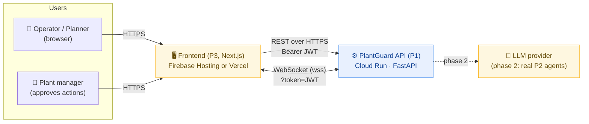

---

## 2. Deployment view (phase 1: demo)

What runs where on Google Cloud.

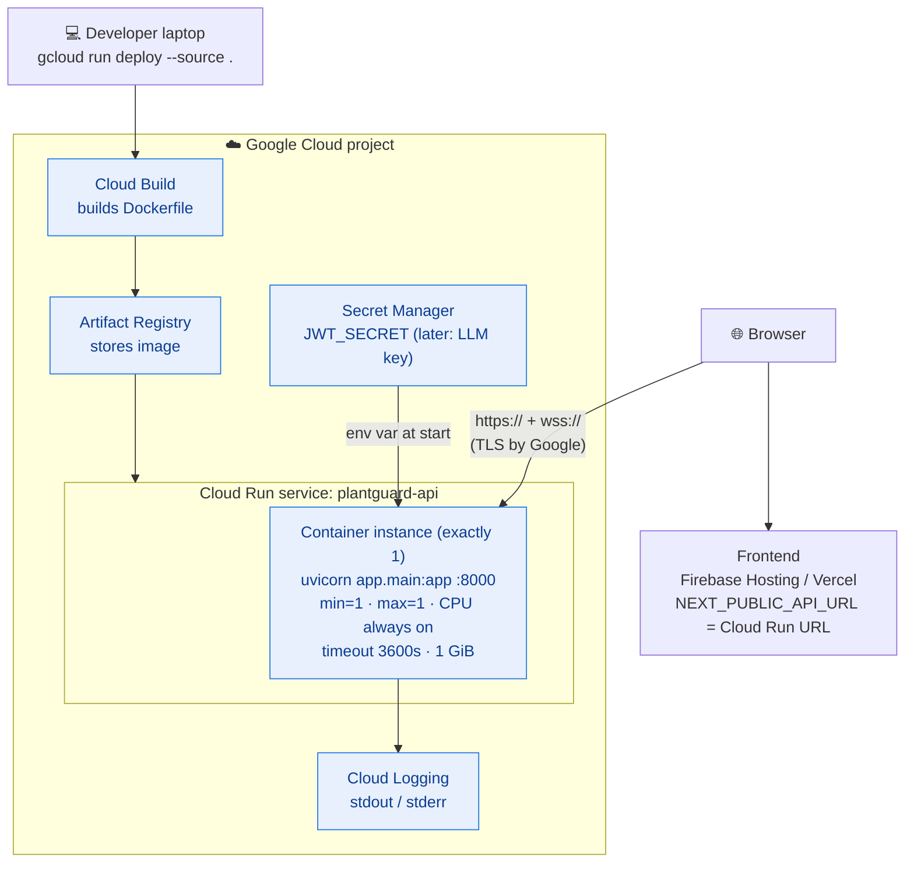

### Cloud Run settings and why

| Setting | Value | Why |
|---|---|---|
| `--port` | `8000` | The Dockerfile's uvicorn listens on 8000 (Cloud Run default is 8080). |
| `--min-instances` | `1` | State lives in memory. If the service scales to zero, incidents and the audit log are lost. |
| `--max-instances` | `1` | Two instances would each have their own incidents and their own event bus. |
| `--no-cpu-throttling` | on | Keeps the `lifespan` background tasks (scoring, alert opener) running between requests. |
| `--timeout` | `3600` | WebSockets close at the timeout. The frontend reconnects with `after_seq`. |
| `--memory` | `1Gi` | Enough for FastAPI + fixtures + synthetic telemetry. |
| `AUTH_MODE` | `local` | Local HS256 personas. Keycloak is skipped in phase 1. |
| `CORS_ORIGINS` | frontend URL | Only the hosted frontend may call the API from a browser. |
| `JWT_SECRET` | from Secret Manager | Never baked into the image. |

---

## 3. Inside the API container

The same layers as local development (see `p1-backend/STRUCTURE.md`).

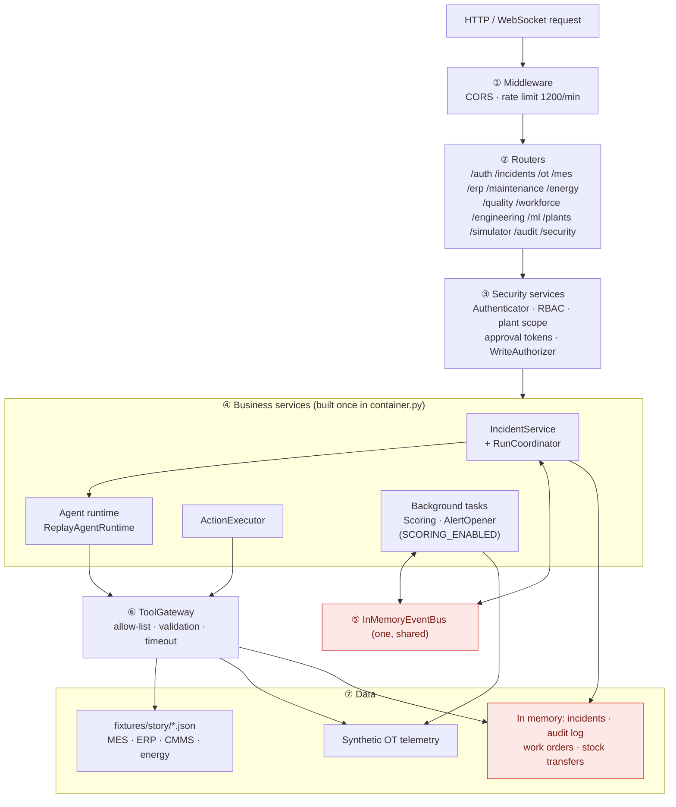

🔴 Red boxes are **lost on restart** (memory only). That is acceptable for the demo and is the reason for `min=max=1`.

---

## 4. Main flow: incident to approved action

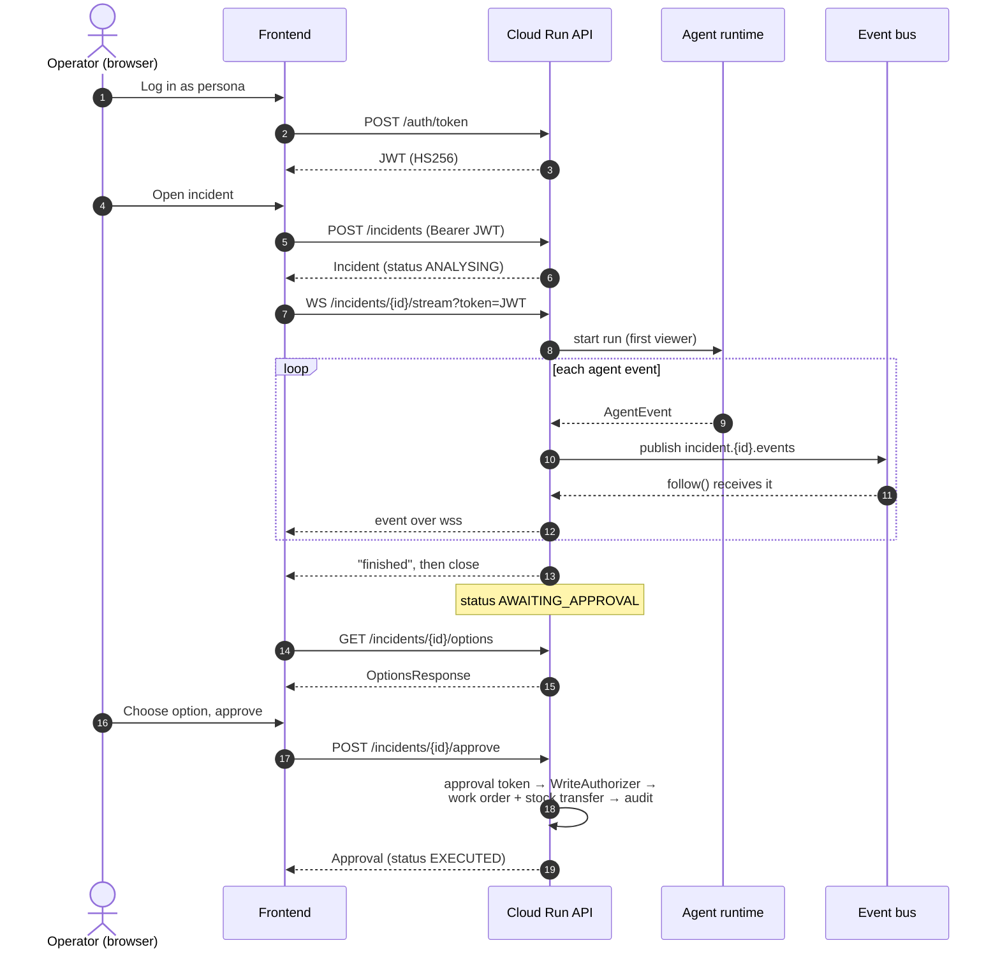

If the WebSocket drops (for example at the 60-minute Cloud Run timeout), the frontend reconnects with `?after_seq=<last seq>` or calls `GET /incidents/{id}/events`.

---

## 5. Live sensor stream

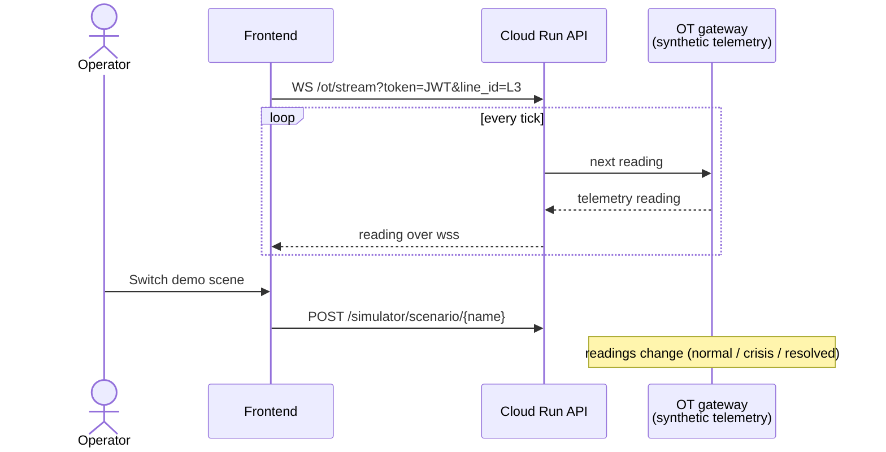

---

## 6. Security on the hosted demo

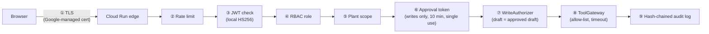

Phase 1 changes compared with the local plan: **Caddy is not needed** (Cloud Run gives HTTPS/WSS), and **Keycloak is off** (`AUTH_MODE=local`).

---

## 7. Phase 2: real persistence and scale (optional)

Only needed once the code actually uses a database, Redis or vectors.

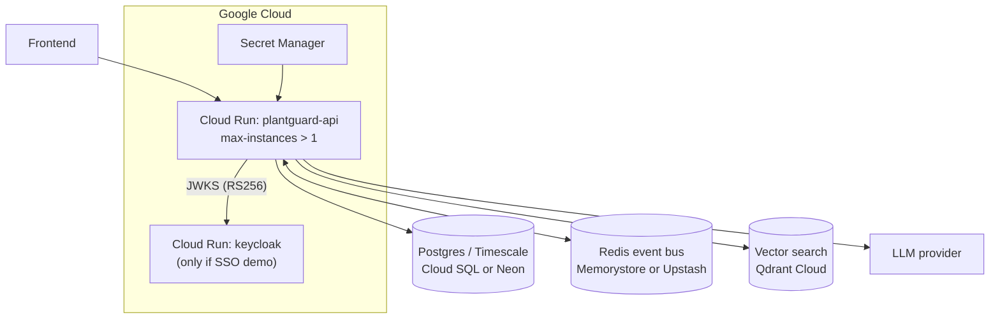

| Phase 1 (now) | Phase 2 (replacement) | Code change |
|---|---|---|
| `InMemoryEventBus` | Redis bus behind the same `EventBus` interface | new adapter in `infrastructure/`, swap in `container.py` |
| In-memory incidents / audit | Postgres repository | new repository class, swap in `container.py` |
| `fixtures/story/*.json` | Postgres tables or real connectors | new connector, swap in `container.py` |
| `ReplayAgentRuntime` | `PlantAgentRuntime` (P2) + LLM key | add `COPY p2-agents` to Dockerfile, swap in `container.py` |
| `AUTH_MODE=local` | `AUTH_MODE=keycloak` | config only |
| `min=max=1` instance | autoscale | only safe after the bus and repositories leave memory |

---

## 8. Deploy commands (phase 1)

```bash
# one-time
gcloud services enable run.googleapis.com cloudbuild.googleapis.com \
  artifactregistry.googleapis.com secretmanager.googleapis.com
printf '%s' "$(openssl rand -hex 32)" | gcloud secrets create plantguard-jwt --data-file=-

# deploy (from repo root)
gcloud run deploy plantguard-api \
  --source . --region europe-west1 --port 8000 \
  --min-instances 1 --max-instances 1 --no-cpu-throttling \
  --timeout 3600 --memory 1Gi --allow-unauthenticated \
  --set-env-vars AUTH_MODE=local,CORS_ORIGINS=https://your-frontend-url \
  --set-secrets JWT_SECRET=plantguard-jwt:latest
```

Then set `NEXT_PUBLIC_API_URL` in the frontend to the Cloud Run URL. The WebSocket base must be `wss://`.

---

## 9. Known limits (phase 1)

- **Restart wipes state:** a redeploy or crash clears incidents, the audit log and created work orders. Re-run the demo scenario after each deploy.
- **One instance only:** no horizontal scaling until the bus and repositories move out of memory.
- **WebSocket max 60 min:** the frontend must reconnect.
- **Cost:** one always-on instance with CPU always allocated is billed continuously. Delete the service, or set `--min-instances 0`, after the demo.

---
---

# Part B: Google-native architecture (recommended)

**Decision:** keep the API as **one Cloud Run service** (as in Part A), and replace each local Docker service with its managed Google Cloud equivalent. Data is saved in **Cloud SQL for PostgreSQL**, which also stores the RAG vectors with **pgvector**, so no separate vector database is needed. The agents' LLM and the embeddings run on **Vertex AI**. The frontend is served by **Firebase Hosting**.

> **managed service** - Google runs the server, applies updates and takes backups. You get a connection or an API.
> **pgvector** - a Postgres extension that stores vectors (lists of numbers that capture meaning) and finds the closest ones with SQL.
> **Vertex AI** - Google's AI platform. It serves Gemini (LLM) and embedding models over an API, with no API key: Cloud Run authenticates as its service account.

---

## B1. Local service → Google Cloud service

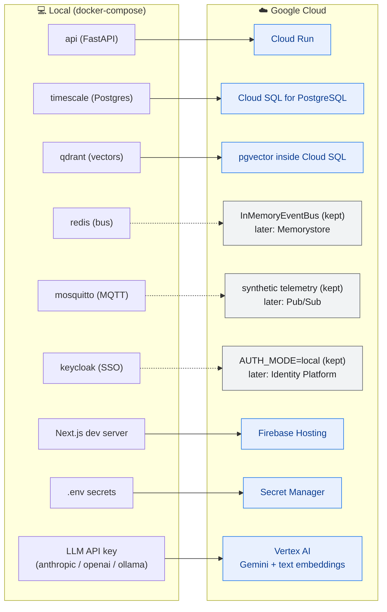

Solid arrows are replaced now. Dashed arrows stay as in Part A for the hackathon and have a named Google upgrade path.

---

## B2. Deployment view

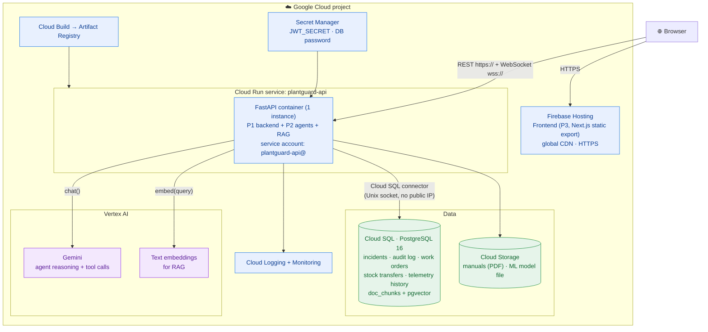

**Why this is better than Postgres on a VM:**

| Concern | Postgres on a VM | Cloud SQL |
|---|---|---|
| Network setup | VPC egress + firewall rules | one flag: `--add-cloudsql-instances` |
| Backups | your own `pg_dump` job | automatic daily backups |
| Updates and patches | you | Google |
| Vectors for RAG | install pgvector yourself | `CREATE EXTENSION vector;` |
| Password in transit | you set up TLS | connector encrypts, IAM-checked |

---

## B3. Who may talk to what (IAM)

Cloud Run runs as its own **service account** and gets only the roles it needs. There are no API keys for Google services.

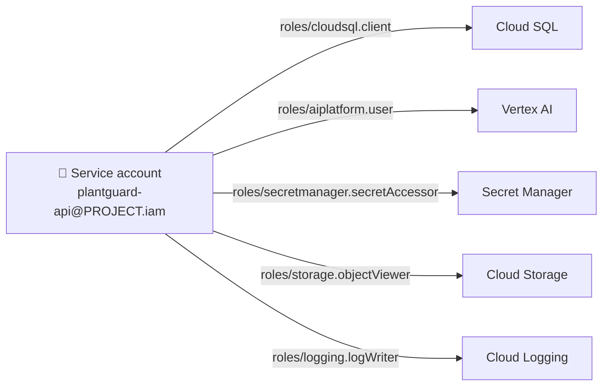

> **service account** - an identity for a program instead of a person. Google checks its roles on every call, so the container needs no stored keys.

---

## B4. Main flow with real agents, Gemini and Cloud SQL

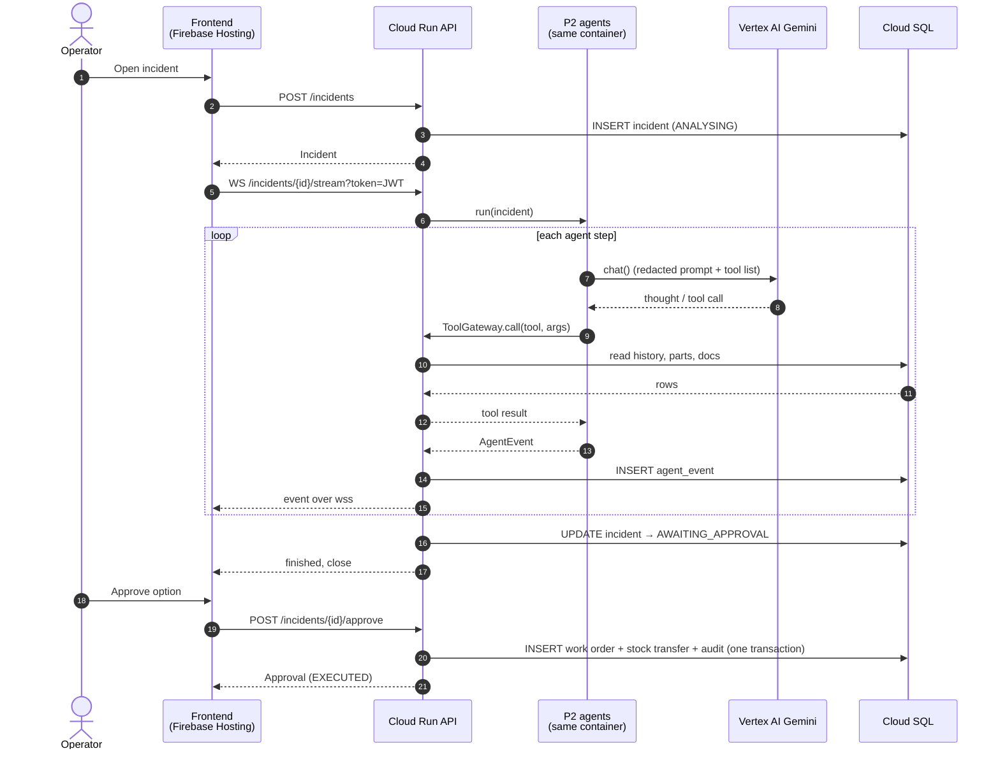

If Gemini is unavailable, P2's runtime falls back to the recorded replay (`agents/replay.py`), so the demo still works.

---

## B5. RAG with pgvector and Vertex AI embeddings

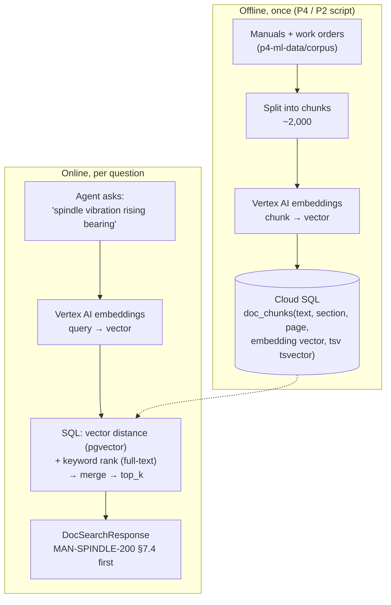

The search is one SQL query (sketch):

```sql
SELECT doc_id, title, section, page, text,
       0.7 * (1 - (embedding <=> :query_vec))            -- meaning match
     + 0.3 * ts_rank(tsv, plainto_tsquery(:query_text)) AS score   -- keyword match
FROM doc_chunks
ORDER BY score DESC
LIMIT :top_k;
```

`HybridRetriever.search` keeps the same `DocSearchRequest` → `DocSearchResponse` contract, so callers do not change.

---

## B6. Data model in Cloud SQL

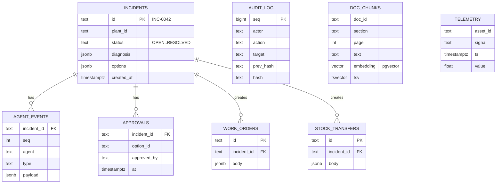

Pydantic models from `plantguard_contracts` are stored as `jsonb`, so the tables stay small and the contract stays the single source of truth. Cloud SQL has no TimescaleDB extension: `TELEMETRY` is a plain table with an index on `(asset_id, ts)`, which is enough for demo volumes.

---

## B7. What changes in the code

The ports-and-adapters design means each Google service is a **new adapter** chosen in `container.py`. Routers, services and the contract stay the same.

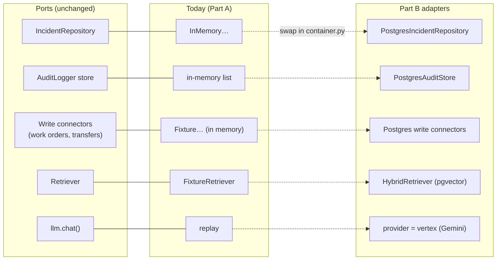

| Owner | Change | Files |
|---|---|---|
| **P1** | Postgres adapters for incidents, agent events, audit log, work orders and transfers; pick them when `DATABASE_URL` is set, else in-memory | new `repositories/postgres_*.py`, `container.py`, `schema.sql` |
| **P1** | Dockerfile: `COPY p2-agents`, `--proxy-headers`, `${PORT}` | `Dockerfile` |
| **P1** | Add `psycopg[binary]`, `pgvector`, `google-cloud-aiplatform` (or `google-genai`) | `requirements.txt` |
| **P2** | `LLM_PROVIDER=vertex` branch in `chat()` calling Gemini (the redactor stays in front) | `p2-agents/llm/client.py` |
| **P2** | `HybridRetriever` on Cloud SQL (SQL above) | `p2-agents/rag/retriever.py` |
| **P4** | Ingest script: chunk corpus → embed → `INSERT doc_chunks` | `p4-ml-data/…/ingest.py` |
| **P3** | `NEXT_PUBLIC_API_URL` = Cloud Run URL; `wss://`; static export for Firebase Hosting | `p3-frontend` |
| **Contract** | Base URL wording only (as in Part A). No schema or endpoint change | `CONTRACTS.md` |

Local development keeps working: without `DATABASE_URL` the in-memory adapters are used, and `LLM_PROVIDER` can stay `anthropic`/`ollama`/replay.

---

## B8. Deploy commands (Part B)

```bash
PROJECT=$(gcloud config get-value project); REGION=europe-west1

# 1. APIs
gcloud services enable run.googleapis.com sqladmin.googleapis.com aiplatform.googleapis.com \
  secretmanager.googleapis.com cloudbuild.googleapis.com artifactregistry.googleapis.com

# 2. Service account + roles
gcloud iam service-accounts create plantguard-api
SA=plantguard-api@$PROJECT.iam.gserviceaccount.com
for r in cloudsql.client aiplatform.user secretmanager.secretAccessor storage.objectViewer logging.logWriter; do
  gcloud projects add-iam-policy-binding $PROJECT --member=serviceAccount:$SA --role=roles/$r; done

# 3. Cloud SQL (smallest tier) + database + user
gcloud sql instances create plantguard-db --database-version=POSTGRES_16 \
  --tier=db-f1-micro --region=$REGION --edition=enterprise
gcloud sql databases create plantguard --instance=plantguard-db
gcloud sql users create plantguard --instance=plantguard-db --password="$(openssl rand -hex 16)"
# then: CREATE EXTENSION vector;  (via gcloud sql connect or Cloud SQL Studio)

# 4. Secrets
printf '%s' "$(openssl rand -hex 32)" | gcloud secrets create plantguard-jwt --data-file=-
printf '%s' "postgresql://plantguard:<pw>@/plantguard?host=/cloudsql/$PROJECT:$REGION:plantguard-db" \
  | gcloud secrets create plantguard-db-url --data-file=-

# 5. API
gcloud run deploy plantguard-api --source . --region $REGION \
  --service-account $SA --add-cloudsql-instances $PROJECT:$REGION:plantguard-db \
  --min-instances 1 --max-instances 1 --no-cpu-throttling --timeout 3600 \
  --concurrency 250 --memory 1Gi --allow-unauthenticated \
  --set-env-vars AUTH_MODE=local,LLM_PROVIDER=vertex,GOOGLE_CLOUD_PROJECT=$PROJECT,GOOGLE_CLOUD_LOCATION=$REGION,CORS_ORIGINS=https://$PROJECT.web.app \
  --set-secrets JWT_SECRET=plantguard-jwt:latest,DATABASE_URL=plantguard-db-url:latest

# 6. Frontend
cd p3-frontend && NEXT_PUBLIC_API_URL=https://<cloud-run-url> npm run build && firebase deploy --only hosting
```

---

## B9. Later upgrades (not needed for the hackathon)

| Need | Google service | Unlocks |
|---|---|---|
| More than one API instance | **Memorystore for Redis** as the event bus | `--max-instances > 1` (incidents are already in Cloud SQL) |
| Real sensor ingest | **Pub/Sub** (or IoT gateway → Pub/Sub) replacing MQTT | live plant data instead of synthetic |
| SSO for real users | **Identity Platform** (new `AUTH_MODE`, a contract addition) | Google / company login |
| Telemetry analytics | **BigQuery** (export from Cloud SQL or Pub/Sub) | long-term trends, model training data |
| Model hosting | **Vertex AI endpoint** for the P4 health model | retrain and deploy models without rebuilding the API |

---

## B10. Known limits (Part B)

- **Still one API instance:** the event bus is in memory, so `max-instances` stays 1 until Memorystore is added. Incidents and audit now survive restarts; open WebSocket streams do not (the frontend reconnects with `after_seq`, and events are read back from Cloud SQL).
- **Cost:** Cloud SQL `db-f1-micro` and one always-on Cloud Run instance are billed continuously. Hackathon credits usually cover this; stop the SQL instance and set `--min-instances 0` after the demo.
- **Gemini quotas:** new projects have low Vertex AI quotas. Keep the replay fallback on for the live demo.
