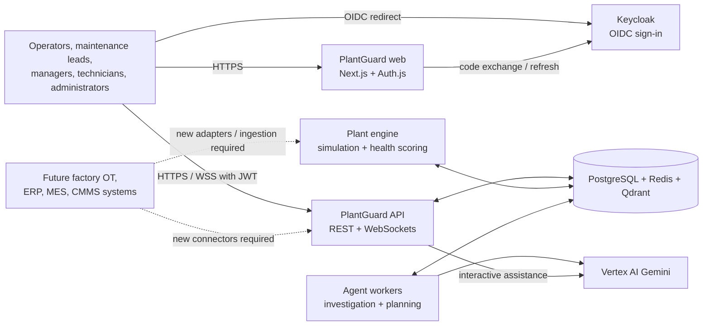
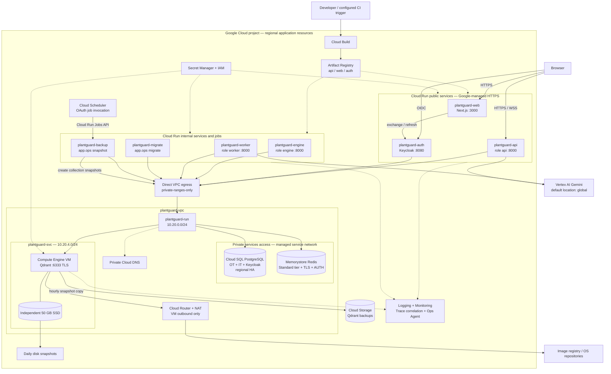
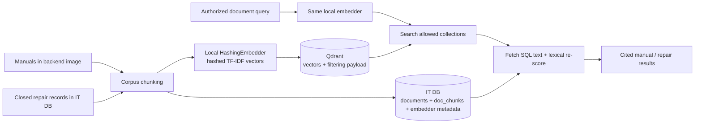
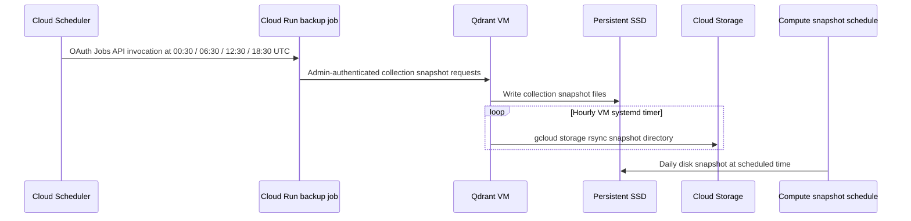
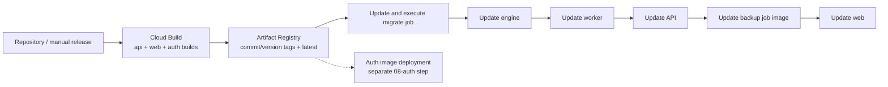

# PlantGuard AI — Google Cloud high-level design

- **Version:** 1.0
- **Baseline reviewed:** repository commit `a2a5d04`, application code, deployment scripts, and configuration examples.
- **Scope:** the current distributed deployment (approach 2), including runtime, data, AI, networking, identity, delivery, observability, and backup services.
- **Validation status:** repository review only; no Google Cloud project inspection, deployment, failover test, or load test was performed for this HLD.

This is the current architecture HLD. The older [`DEPLOYMENT_HLD.md`](../DEPLOYMENT_HLD.md) is historical; use the [`GCP_DEPLOYMENT_GUIDE.md`](GCP_DEPLOYMENT_GUIDE.md) for deployment commands and troubleshooting.

## 1. Executive summary

PlantGuard detects developing equipment faults, runs AI-assisted investigations, proposes repair options, obtains human approvals, and follows repairs through verification and closure.

The implementation uses:

- **Five Cloud Run services:** Next.js web, FastAPI API, plant engine, agent worker, and Keycloak authentication.
- **Two Cloud Run jobs:** migration/index initialization and Qdrant collection snapshots.
- **Cloud SQL for PostgreSQL:** the durable system of record, with separate OT, business/IT, and Keycloak databases.
- **Memorystore for Redis:** live event distribution, analysis queue, caches, leases, and single-use approval markers.
- **Qdrant on Compute Engine:** a private, self-managed vector database with an independent persistent SSD.
- **Vertex AI Gemini:** agent reasoning and interactive assistance, authenticated by service accounts.
- **Supporting cloud services:** Secret Manager, Artifact Registry, Cloud Build, Cloud Storage, Cloud Scheduler, VPC networking, Cloud DNS, Cloud NAT, IAM, IAP, Logging, Monitoring, and Trace correlation.

**Important boundaries:** this is a single-region architecture, not a fully highly available application. Cloud SQL and Redis have HA configurations, but Qdrant and Keycloak each run as a singleton. The deployed plant data is simulated; real factory ingestion and enterprise connectors are future integration work.

## 2. Scope, assumptions, and design decisions

### 2.1 Deployment assumptions

| Item | Reviewed default | Meaning |
|---|---|---|
| Resource prefix | `plantguard` | Resource examples below assume `NAME=plantguard` |
| Region / VM zone | `asia-south1` / `asia-south1-a` | Configurable; check quotas and product availability before provisioning |
| Environment | `prod` | Production application controls, not proof of production readiness |
| Plants | `PLANT-A`, `PLANT-B` | Used for seeded data and vector collection permissions |
| Data mode | `DATA_MODE=sim` | Engine generates the operational plant data |
| Authentication | `AUTH_MODE=keycloak` | Keycloak OIDC; API retains authorization responsibility |
| Vertex location | `global` | AI requests are not necessarily confined to the application region |
| Plant clock | Scale `60` in `config/simulation.ini` | One real minute represents one plant hour; not a real-time factory deployment |

Configuration templates are [`deploy/gcp/config.example.cmd`](../deploy/gcp/config.example.cmd) and [`deploy/gcp/config.env.example`](../deploy/gcp/config.env.example). Do not reuse their sample project ID or alert email without reviewing them.

### 2.2 Architecture decisions

| Decision | Rationale / trade-off |
|---|---|
| Cloud Run rather than GKE for the application | Managed container runtime with simple releases; persistent background work needs minimum instances and continuously allocated CPU |
| One backend image, separate roles | Same contracts and adapters; API, engine, and agents can be operated independently |
| PostgreSQL as system of record | Incidents, events, approvals, repairs, document text, and audit survive application restarts |
| Redis for coordination, not authoritative business storage | Fast fan-out and work dispatch; recovery must account for lost coordination state |
| Qdrant rather than Cloud SQL pgvector | Matches the implemented adapter and collection-level permissions; introduces VM maintenance and a single point of failure |
| Cloud Run for Next.js | Frontend is a standalone server using Auth.js routes, not a static Firebase Hosting export |
| Keycloak rather than Identity Platform | Matches existing realm, claims, and token verification; single-instance deployment limits authentication availability |
| Local hashing embeddings | Current RAG implementation needs no embedding API; Vertex AI serves Gemini, not embeddings |
| Private data endpoints | Databases and Qdrant have no public endpoint; public browser traffic reaches only web, API, and auth |
| Human-controlled writes | LLM recommendations do not bypass role, plant-scope, approval, or tool execution checks |

## 3. System context



The browser calls the backend directly using the build-time `NEXT_PUBLIC_API_URL`. The web service handles sign-in and session callbacks; it is not the general REST/WebSocket proxy. Current ERP/MES/CMMS views use the application's SQL-backed simulated business data, not live SAP or factory systems.

## 4. Complete cloud service inventory

**Status legend:** **Scripted** means resource creation/configuration is present in the repository, not that the resource has been observed in a live project. **Integrated** means the application or platform uses the capability. Optional future services are listed separately in section 14.

| Cloud service / capability | Resources or use | Purpose and consumers | Status / source |
|---|---|---|---|
| Cloud Run services | `plantguard-web`, `-api`, `-engine`, `-worker`, `-auth` | Public web/API/auth and private background roles | Scripted: `08-auth.*`, `10-services.*` |
| Cloud Run jobs | `plantguard-migrate`, `plantguard-backup` | Schema/index setup and scheduled collection snapshots | Scripted: `09-migrate.*`, `10-services.*` |
| Cloud SQL for PostgreSQL 16 | `plantguard-pg`; `plantguard_ot`, `plantguard_it`, `keycloak` | Durable OT, business, workflow, document, audit, and identity storage | Scripted: `04-database.*` |
| Memorystore for Redis 7.2 | `plantguard-redis` | Pub/sub, streams, shared cache, engine lease, approval markers, rate limiting | Scripted: `05-redis.*` |
| Compute Engine | `plantguard-qdrant` | Runs Qdrant Docker container on private Debian 12 VM | Scripted: `06-qdrant.*` |
| Persistent Disk | `plantguard-qdrant-data`; separate VM boot disk | Qdrant vectors and local collection snapshots; data disk survives VM deletion | Scripted: `06-qdrant.*` |
| Compute Engine snapshot schedules | `plantguard-daily` | Daily data-disk snapshots, 14-day retention policy | Scripted: `06-qdrant.*` |
| Cloud Storage | `gs://<PROJECT_ID>-plantguard-backups` | Off-VM Qdrant collection snapshots | Scripted: `06-qdrant.*`; VM startup script |
| Vertex AI | Gemini, default `gemini-2.5-flash` | Tool-calling agents, options chat, assistance; service-account authentication | Integrated: `p2-agents/llm/`, backend environment |
| Secret Manager | `plantguard-*` secrets | DB/Redis credentials, JWT signing, Qdrant keys/CA/certificates, web/Keycloak secrets and realm | Scripted: `03-secrets.*`, later provisioning steps |
| Artifact Registry | `<REGION>-docker.pkg.dev/<PROJECT_ID>/plantguard` | Stores `api`, `web`, and `auth` images | Scripted: `01-foundation.*`, `cloudbuild.yaml` |
| Cloud Build | Image build and optional release pipeline | Builds/pushes images, runs migrate, updates backend/web revisions | Scripted: `07-build.*`, `release.bat`, `cloudbuild.yaml`; trigger is manual setup |
| VPC and subnets | `plantguard-vpc`, `plantguard-run`, `plantguard-svc` | Private routes for Cloud Run egress and Qdrant VM | Scripted: `02-network.*` |
| Direct VPC egress | Cloud Run network/subnet flags | Backend roles, auth, and jobs reach private data services without a VPC connector | Scripted: `lib.sh`, Windows helpers |
| Private services access / Service Networking | `plantguard-psa` reserved range and peering | Private access to managed SQL and Redis | Scripted: `02-network.*` |
| VPC firewall rules | `plantguard-qdrant-from-run`, `plantguard-iap-ssh` | Restricts Qdrant REST and administrative SSH | Scripted: `02-network.*` |
| Cloud Router + Cloud NAT | `plantguard-router`, `plantguard-nat` | Outbound internet access for Qdrant VM updates and image pulls; no inbound publication | Scripted: `02-network.*` |
| Cloud DNS private zone | `plantguard-internal`; `qdrant.plantguard.internal` | Stable private name for Qdrant TLS endpoint | Scripted: `02-network.*`, `06-qdrant.*` |
| Private Google Access | Enabled on both subnets | Enables eligible private-address workloads to reach Google APIs; not a service perimeter | Scripted: `02-network.*` |
| VPC Flow Logs | Enabled on both subnets | Network flow visibility in Cloud Logging | Scripted: `02-network.*` |
| IAM / service accounts | Eight component accounts plus build identity | Google API access, per-secret permissions, scheduler job invocation | Scripted: `01-foundation.*`, `03-secrets.*`, `06-qdrant.*` |
| Identity-Aware Proxy + OS Login | IAP SSH tunnel to Qdrant; OS Login enabled | Operator access without public SSH; user IAM grants still required | Scripted network/VM configuration; operator grants are a prerequisite |
| Cloud Scheduler | `plantguard-backup` HTTP trigger | Calls Cloud Run Jobs API every six hours with OAuth | Scripted: `10-services.*` |
| Cloud Logging | Application JSON logs, Cloud Build logs, VM logs, backend error metric | Request investigation, security/operational diagnosis | Integrated + scripted: observability code, `11-observability.*` |
| Cloud Monitoring | Uptime checks, email channel, threshold policies, platform metrics | API/web availability signals and resource saturation alerts | Scripted: `11-observability.*` |
| Cloud Trace | Trace API enabled, backend roles granted trace permission | Application logs correlate with incoming trace IDs; full custom span instrumentation is not implemented | Partial integration: `app/core/observability.py` |
| Google Cloud Ops Agent | Installed on Qdrant VM by startup script | VM telemetry collection; validate Docker/journald log collection configuration | Scripted install: `deploy/qdrant/startup.sh` |
| Service Usage / project control plane | API enablement and project configuration | Makes the above APIs available; project and billing must already exist | Scripted API enablement: `01-foundation.*` |

Keycloak and Qdrant are **self-managed software hosted on Google Cloud**, not Google-managed identity/vector services. Platform-managed build staging/artifact storage is separate from the application backup bucket.

## 5. Deployment architecture



Cloud Run containers are not VMs placed inside the VPC. Direct VPC egress attaches their outbound connectivity to the chosen subnet. SQL and Redis use a peered managed-service network. Diagram groupings describe trust/connectivity boundaries, not a claim that every service is physically inside one subnet.

### 5.1 Runtime sizing and ingress

| Component | Exposure / port | Min–max instances | CPU / RAM | Key behavior |
|---|---|---|---|---|
| Web | Public HTTPS / container `3000` | 1–5 | 1 vCPU / 1 GiB | Next.js standalone; Auth.js session routes; concurrency 80 |
| API | Public HTTPS/WSS / container `8000` | 1–10 | 2 vCPU / 2 GiB | Concurrency 80, 3,600 s timeout, session affinity, CPU always allocated |
| Engine | Internal ingress, authenticated invocation / `8000` | 1–1 | 1 vCPU / 1 GiB | Background simulation/scoring; CPU always allocated; Redis leader lease |
| Worker | Internal ingress, authenticated invocation / `8000` | 1–5 | 2 vCPU / 2 GiB | Background Redis consumption; CPU always allocated; four runs per instance |
| Auth | Public HTTPS / container `8080` | 1–1 | 2 vCPU / 2 GiB | Keycloak 26, PostgreSQL-backed, local cache; 300 s request timeout |
| Migrate job | No browser endpoint | 1 task | 2 vCPU / 2 GiB | 1,800 s task timeout; one retry |
| Backup job | No browser endpoint | 1 task | 1 vCPU / 1 GiB | 900 s task timeout; two retries |
| Qdrant VM | Private HTTPS REST `6333` | One VM | `e2-standard-2` | Qdrant `v1.13.4`, Docker restart policy, Debian 12; 50 GB data SSD |

Backend services use gen2 execution, startup CPU boost, HTTP startup probe `/readyz`, and liveness probe `/healthz`. Keycloak uses a TCP startup probe on port 8080. The deployed web command does not define equivalent explicit probes.

**Public Cloud Run invocation does not mean public business data.** `--allow-unauthenticated` permits reaching the application; the API still requires a valid Keycloak token for protected routes.

### 5.2 Data and supporting service defaults

| Resource | Scripted default |
|---|---|
| Cloud SQL | PostgreSQL 16 Enterprise, `db-custom-2-7680` (2 vCPU / 7.5 GiB), regional HA, 50 GB SSD with automatic storage growth |
| Redis | Memorystore 7.2 Standard tier, 1 GiB configured capacity, AUTH/TLS and hourly RDB configuration |
| Qdrant storage | 50 GB `pd-ssd` data disk, separate 20 GB `pd-balanced` boot disk |
| Backup bucket | Regional Standard storage, object versioning, uniform bucket-level access, public access prevention |
| Artifact Registry | Regional Docker repository; version/commit and `latest` tags; no image cleanup policy scripted |
| Cloud Build | `E2_HIGHCPU_8`, 2,400 s pipeline timeout, Cloud Logging-only build logs |
| Secret Manager | Automatic replication; review regional secret residency requirements separately |

Resource sizes and replication choices are configuration defaults, not benchmarked capacity or residency guarantees.

## 6. Networking and transport

### 6.1 Connection matrix

| Source → destination | Protocol / port | Route and authentication |
|---|---|---|
| Browser → web, API, auth | HTTPS/WSS `443` | Cloud Run managed TLS; Auth.js session or Keycloak bearer JWT as appropriate |
| Web → auth | HTTPS `443` | OIDC discovery, code exchange and refresh; confidential client credentials |
| Backend → auth | HTTPS `443` | JWKS retrieval using the public issuer URL; cached signing keys |
| Backend services/jobs → OT and IT SQL | PostgreSQL `5432` | Direct VPC egress + private services access; DB password; `sslmode=require` |
| Auth → Keycloak SQL | PostgreSQL `5432` | Same private route; dedicated Keycloak DB user/password |
| Backend services/jobs → Redis | TLS `6378` | Private services access; Redis AUTH and mounted server CA |
| Backend services/jobs → Qdrant | HTTPS REST `6333` | Private VM IP resolved through Cloud DNS; private CA validation and Qdrant JWT/admin key |
| API/worker → Vertex AI | HTTPS `443` | Google API endpoint; attached service-account credentials |
| Qdrant VM → Google APIs / external registries | HTTPS `443` | Private Google Access / Cloud NAT as applicable; attached VM identity for Google APIs |
| Scheduler → Cloud Run Jobs API | HTTPS `443` | OAuth token issued for `plantguard-scheduler`; IAM job invocation |
| Operator → Qdrant VM | SSH `22` through IAP | IAP tunnel, OS Login and user IAM; source range `35.235.240.0/20` |

### 6.2 Network controls

- Custom-mode VPC with a `/24` Cloud Run egress subnet, `/24` VM subnet, and an automatically allocated private services range with prefix length `16`.
- SQL has no assigned public IP. Redis is private. Qdrant has no external VM IP.
- Qdrant REST firewall allows TCP 6333 from the **two configured subnets**. IAP SSH allows TCP 22 from the IAP range only.
- The Qdrant container also publishes gRPC port 6334 on the VM, but no corresponding ingress allow rule is scripted; application clients use REST (`prefer_grpc=False`).
- Cloud NAT covers the **VM subnet only**, not all Cloud Run traffic. `private-ranges-only` egress leaves public Google API calls outside that private egress route; it does not enforce private-only Vertex access.
- No external load balancer, Cloud Armor policy, public custom DNS, or VPC Service Controls perimeter is provisioned.
- Cloud SQL enforces encrypted transport, but `sslmode=require` is not explicit server-identity verification. A stronger verified TLS/connector design is a hardening action, not an existing control.

## 7. Application components and data ownership

### 7.1 Backend roles

The root [`Dockerfile`](../Dockerfile) packages P1 backend, P2 agents, contracts, fixtures, configuration, and the document corpus. `PLANTGUARD_ROLE` selects activity in [`app/sim/wiring.py`](../p1-backend/app/sim/wiring.py).

| Role | Responsibilities | Shared dependencies |
|---|---|---|
| `api` | REST, WebSockets, authorization, options chat, approval/repair requests | OT/IT SQL, Redis, Qdrant; Vertex for interactive AI |
| `engine` | Simulated telemetry, historian updates, health scoring, fault alerts, repair verification, startup recovery | OT/IT SQL, Redis; Qdrant is also wired/readiness-checked |
| `worker` | Consume queued rounds, run configured agents/tools, persist investigation events/results | OT/IT SQL, Redis, Qdrant, Vertex |
| `migrate` | Schema creation/upgrades, seed if empty, initialize vector index | OT/IT SQL, Redis configuration, Qdrant admin access |
| `all` | Single-process local alternative | SQLite + FAISS by default; not the distributed cloud baseline |

Normal engine/worker work arrives through Redis, not HTTP calls from the API. All distributed roles require PostgreSQL, Redis, and Qdrant configuration at startup.

### 7.2 Storage model

| Data domain | Authoritative store | Derived / transient store |
|---|---|---|
| Plants, lines, equipment, conditions, historian, alarms, machine state | `plantguard_ot` | Latest telemetry and health values in Redis |
| ERP/MES/CMMS, stock, suppliers, orders, schedules, work orders, workforce, defects | `plantguard_it` | Application projections/caches |
| Incidents, rounds/events, options, approvals, repair verification, feedback, options chat | `plantguard_it` | Redis notifications and analysis queue |
| Application users, plant mappings, local sessions, audit, ID sequences, plant clock anchors | `plantguard_it` | Redis coordination markers |
| Keycloak realm/users/credentials/sessions | `keycloak` | Single-instance local Keycloak cache |
| Document catalogue, chunks/text, embedder vocabulary/IDF metadata | `plantguard_it` | Qdrant vectors and filtering payload |
| Qdrant vectors and collection snapshots | Qdrant persistent disk | Disk snapshots and copies in Cloud Storage |
| Approval single-use markers, run deduplication, rate counters, engine lease | Redis | Not equivalent to durable PostgreSQL records |

The three databases share **one Cloud SQL instance**: logical separation is not separate failure domains, and OT/IT transactions do not become distributed transactions simply because they share a server. PostgreSQL grants require the additional [`grants.sql`](../deploy/gcp/sql/grants.sql) administration step; their existence is not guaranteed by resource creation alone.

### 7.3 Concurrency and consistency

- Atomic database ID sequences prevent duplicate incident/work-order IDs across processes.
- `incidents.version` implements optimistic locking; conflicting edits return HTTP 409, while agent saves have merge/retry logic.
- Audit appends and schema/index initialization use PostgreSQL advisory locks.
- Engine lease has a **15-second TTL**, renewed approximately every five seconds. Loss of lease cancels guarded plant tasks; it protects deploy overlap but is not a formal database fencing guarantee.
- Redis Streams consumer group `workers` dispatches runs. Workers heartbeat every **30 seconds** and reclaim idle entries after **300 seconds** by default.
- Incident events are saved before Redis notification publication. Pub/sub is **at-most-once** notification delivery; PostgreSQL event history is the catch-up source.
- There is no atomic transaction across PostgreSQL, Redis queue publication, and Qdrant updates. Durable outbox/reconciliation controls are recommended for stronger recovery guarantees.

## 8. AI, RAG, and predictive health

### 8.1 LLM execution

P2 uses a configured agent harness with orchestrator, diagnosis, spare-parts, scheduler, energy, decision, and manual-research roles. The harness calls LiteLLM; `GOOGLE_GENAI_USE_ENTERPRISE=True` converts `gemini/<model>` to `vertex_ai/<model>` using `GOOGLE_CLOUD_PROJECT` and `GOOGLE_CLOUD_LOCATION`.

- Default model: `gemini-2.5-flash`, defined in [`p2-agents/config/agents.ini`](../p2-agents/config/agents.ini).
- Cloud authentication: attached service account; no Gemini API key is required for this path.
- Prompts/tool outputs pass through the redaction layer, and tools remain allow-listed and validated.
- Cost/planning calculations are deterministic application code, not trusted LLM arithmetic.
- In **sim mode**, `config/simulation.ini` selects `on_llm_failure=degrade`: agents use rule-based processing on the live simulated incident. The recorded `INC-0042` replay is a fixtures-mode safety net, not the universal cloud fallback.
- The shell template's `LLM_MODEL` value is not wired into the backend environment; change the agent configuration/image to change the active model.

### 8.2 RAG data path



Collections for the default environment:

| Collection | Application permission | Scope |
|---|---|---|
| `plantguard_prod_manuals` | Read | Shared equipment manuals |
| `plantguard_prod_workorders_plant_a` | Read/write | Closed Plant A repairs |
| `plantguard_prod_workorders_plant_b` | Read/write | Closed Plant B repairs |

The current app token grants all configured plant collections to backend services. **Per-user isolation is enforced by application plant scope and catalogue filtering**, with collection permissions limiting the overall service boundary. The default deployment does not issue a different Qdrant token for every signed-in user.

Text is retained in PostgreSQL, so vectors are rebuildable. A technician's closed repair becomes new searchable knowledge. There is no Vertex embedding model, Vertex Vector Search, pgvector adapter, PDF upload bucket, or online corpus ingestion service in the current deployment.

### 8.3 Predictive health

The distributed sim path uses `SignatureHealthModel` and `SignatureFeatureExtractor` in the backend process, driven by `config/plant.yaml` signatures and historian data. Engine scoring runs every five real seconds by default and emits fault/health events. This is separate from Gemini and is **not a Vertex AI prediction endpoint**. The older optional P4 model-artifact path is not the cloud sim runtime baseline.

## 9. Main end-to-end flows

### 9.1 Sign-in and request authorization

1. Browser loads the web service and starts Keycloak sign-in through Auth.js.
2. Authorization code + PKCE flow exchanges the code server-side; the confidential client secret remains on the web service.
3. Auth.js maintains its encrypted session and refreshes the 15-minute access token shortly before expiry.
4. Browser sends the Keycloak access token to the API. API verifies RS256 signature, issuer, audience, expiry, role and plant claims.
5. WebSocket connections use the same authorization policy; query tokens require special care in platform/proxy logging.
6. API services and tools enforce permissions independently of what the UI displays.

### 9.2 Detection, analysis, and streaming

```mermaid
sequenceDiagram
    autonumber
    participant E as Cloud Run engine
    participant DB as Cloud SQL OT / IT
    participant R as Redis
    participant W as Cloud Run worker
    participant V as Vertex AI Gemini
    participant Q as Qdrant
    participant A as Cloud Run API
    actor U as Browser

    E->>R: Acquire / renew plant-engine lease
    E->>DB: Update telemetry history and plant state
    E->>R: Publish telemetry and latest scores
    E->>DB: Create incident when health policy triggers
    E->>R: Queue incident analysis round
    W->>R: Claim run; heartbeat while active
    W->>DB: Load authorized incident / business context
    loop Agent steps
        W->>V: Redacted prompt and allowed tools
        V-->>W: Text / requested tool calls
        W->>DB: Read data through local ToolGateway
        W->>Q: Retrieve relevant authorized document vectors
        W->>DB: Persist agent event / result
        W->>R: Publish event notification
        R-->>A: Incident event notification
        A-->>U: WSS event to subscribed viewer
    end
    W->>DB: Persist options / awaiting-approval status
    W->>R: Acknowledge and delete completed queue entry
```

The worker's ToolGateway is in the worker process; tool use is not necessarily an HTTP round trip to the API. Incident analysis starts automatically when opened, not only when the first browser connects.

On reconnect, clients pass `after_seq`; the API subscribes before reading stored history to reduce the history/live handoff gap. Interrupted worker rounds may drop partial events and restart, so recovery is a **round restart**, not continuation of a saved LLM session.

### 9.3 Human approval and repair

1. Maintenance lead selects and approves an option.
2. If parts come from another plant, that plant's lead must release them. A manager co-sign is required above configured cost/downtime limits (defaults: over EUR 10,000 or over four plant hours).
3. Backend checks the current option, complete approval chain, plant scope, and short-lived approval token.
4. WriteAuthorizer and ActionExecutor gate speed plans, stock transfers, purchases and work orders; Redis atomically tracks token use **per allowed action kind**.
5. Technician can start only after required parts arrive; repair completion restarts the machine and begins verification.
6. Engine verifies risk/alarm conditions. Technician closes a successful repair; the log becomes RAG knowledge. Failed verification can initiate another analysis round.
7. Durable records and hash-chained audit entries remain in PostgreSQL.

These steps span multiple stores and service operations; this HLD does not claim the entire workflow is one atomic transaction.

### 9.4 Scheduled backup



Backup job success confirms collection snapshot creation, **not** completion of the subsequent Cloud Storage upload. Monitor both independently.

## 10. Security architecture

### 10.1 Service identity and IAM

Service-account names use `<NAME>-<component>@<PROJECT_ID>.iam.gserviceaccount.com`.

| Account | Google project roles / resource access in scripts | Credential boundary |
|---|---|---|
| API / engine / worker | Logging writer, metric writer, trace agent, Vertex user | App DB password, Redis AUTH/CA, Qdrant app JWT/CA, approval JWT secret |
| Ops | Logging/metric writer, Vertex user | Backend operational secrets plus Qdrant admin key; no default Qdrant app JWT grant |
| Web | Logging/metric writer | Auth.js session secret and Keycloak client secret |
| Auth | Logging/metric writer | Keycloak DB/admin passwords and imported realm |
| Qdrant | Logging/metric writer; bucket-level Storage object admin | Qdrant admin key and TLS files/CA |
| Scheduler | `roles/run.invoker` at project scope | OAuth service identity; no application secrets |
| Build identity | Run admin, Artifact Registry writer, impersonation/use of runtime accounts | Assumed default Compute Engine service account; verify actual build account |

Runtime code uses attached identities; do not add downloaded service-account JSON keys. Secret access is granted on individual secrets, not blanket project-wide secret access. Some roles are broader than the component strictly needs: tighten engine Vertex access, ops Vertex access, scheduler invocation scope, build deployment permissions, and bucket object permissions after validating required operations.

SQL clients use **database username/password authentication**, not IAM database login. The instance flag enabling IAM authentication does not change that application behavior, and the current private-IP path does not use the Cloud SQL Auth Proxy/connector.

### 10.2 Secret lifecycle

- Random secrets are generated and stored as Secret Manager versions; Cloud Run receives secret-backed environment variables or mounted CA files.
- Generated Qdrant app token is valid for 365 days by default. Rotation requires re-minting and rolling application services.
- Qdrant private CA/server material is generated during provisioning; rotating CA requires updating both server and clients.
- Most mounts/environment bindings use `latest`; release-safe version pinning and coordinated rotation are recommended.
- Initial Keycloak user passwords are deliberately exported to `deploy/gcp/initial-passwords.csv`; distribute securely and delete it. Realm/certificate generation also uses temporary local files. This is not a zero-local-secret-files deployment process.
- Keycloak realm imports only create a missing realm. Later changes to users, clients, redirects or policies need administrative updates; redeploying a new secret-mounted realm does not overwrite the existing one.

### 10.3 Application controls and limitations

- RBAC, plant scoping, tool allow-lists, request validation, approval checks, and PostgreSQL audit chain.
- Production mode hides API documentation by default, rejects wildcard CORS, and prevents service-side reset settings; review exceptions in code rather than treating the flag as a complete hardening standard.
- The current startup strength check for `JWT_SECRET` is conditional on local auth, although approval tokens use that secret in Keycloak mode too. Enforce a strong secret in both modes before production.
- HSTS and other response security headers; backend log filter redacts bearer/query-token strings. Validate Google-managed request logs and any future proxy logs separately.
- Shared rate limiter fails open on Redis errors; it is not an independent edge protection control.
- Audit chain detects record alteration but is not immutable/WORM storage; a privileged actor able to rewrite the database can rebuild the chain. Independent protected audit export is future hardening.
- Restrict Keycloak administration and require MFA for privileged users; these additional controls are not provisioned by the baseline.

## 11. Availability, recovery, and backups

### 11.1 Actual failure domains

| Component | Current resilience | Limitation / expected response |
|---|---|---|
| API / web | Multiple allowed Cloud Run instances/revisions | Streams disconnect on timeout/replacement; reconnect and catch up; validate release capacity |
| Engine | Singleton with lease protecting revision overlap | Replacement and lease acquisition take time; no hot independent plant-engine standby |
| Worker | Queue-driven runs, heartbeat, reclaim | Crashed runs restart after idle threshold; no guaranteed queue-depth autoscaling |
| Keycloak | Persistent SQL state | One local-cache service instance; login/refresh can be interrupted |
| Cloud SQL | Regional HA, automated backups, PITR | One shared database instance; failover can interrupt connections; no cross-region DR |
| Redis | Standard tier, failover, hourly RDB configuration | Not zero-loss durable messaging or approval-use storage |
| Qdrant | Docker restart, separate data disk, snapshots | One zonal VM; outage blocks RAG and backend startup readiness; snapshots are backup, not HA |
| Whole application | Regional managed runtime | No scripted second-region deployment, global failover, or tested application SLO |

### 11.2 Retention and recovery

| Store | Scripted protection | Recovery design |
|---|---|---|
| Cloud SQL | Daily backup at 20:00 UTC, 14 retained backups, seven days of transaction logs/PITR; deletion protection | Restore/clone to a selected point, validate all three databases, update connections, roll services |
| Redis | Standard replica/failover, AUTH/TLS, hourly RDB configuration | Refill caches; reconcile run state and security markers explicitly after state loss |
| Qdrant data disk | Daily snapshot schedule at 19:00 UTC, 14-day policy; data disk `auto-delete=no` | Recover collection, replace disk/VM, or rebuild from SQL and corpus |
| Collection backups | Every six hours; hourly copy to Storage | Nominal off-VM snapshot lag can approach seven hours plus execution delays; not an RPO guarantee |
| Backup bucket | Uniform access, public access prevention, versioning; delete live objects after 30 days and noncurrent versions after seven days | Recover selected snapshot object; retention is lifecycle policy, not locked retention |

Snapshot files accumulate on the Qdrant disk; the current startup script does not prune them. Bucket lifecycle can delete an old object while the hourly directory sync later uploads the still-present local file again. Add coordinated local snapshot cleanup and verify effective retention/storage growth.

### 11.3 Redis data-loss caveat

The engine's recovery routine requeues **never-started** analysing rounds when the engine starts. It does not fully reconcile already-started runs if the Redis stream disappears, and it is not a continuously scheduled reconciler. Lost single-use markers can also weaken token replay protection until expiry or explicit invalidation.

Before claiming end-to-end recovery: implement a PostgreSQL-backed dispatch/outbox or equivalent reconciliation, durable write idempotency, and tested token invalidation/replay handling. Do not equate Redis HA or RDB snapshots with guaranteed analysis delivery.

**Recovery targets:** RTO, RPO, availability SLOs, and restore success times must be agreed and measured; this HLD intentionally does not invent them from infrastructure settings. Drill SQL point-in-time recovery, Qdrant recovery/reindex, Redis loss, and interrupted agent rounds before go-live.

## 12. Scalability, observability, and cost

### 12.1 Capacity planning

- API concurrency is 80 **total in-flight requests per instance**; open WebSockets consume slots. Ten instances represent at most roughly 800 such slots before allowing room for normal HTTP requests, and this is not a tested user-capacity promise.
- Worker slots are `ready worker instances × WORKER_CONCURRENCY`: four at the default minimum, up to 20 at the configured maximum if all five instances exist.
- Worker services poll Redis internally. Cloud Run CPU scaling does not directly scale on Redis queue depth, and LLM waits may consume little CPU. Size the minimum pool for demand or add a queue-depth-aware scaling mechanism.
- DB pool maximum is eight connections **per database per backend process**. A planning estimate with ten APIs, five workers, one engine and two job tasks is `18 × 2 × 8 = 288`, before Keycloak, administration, rollout overlap and safety margin. `max_connections=500` is a configured ceiling, not proof the chosen SQL tier can sustain that workload.
- Engine is one shared simulated plant driver. Real multi-plant scale requires separately designed ingestion/ownership, not simply raising `engine` max instances.
- Monitor historian and audit/event growth. Sim historian defaults are 72 plant hours with five-plant-minute samples; business/audit retention is a separate policy to define.

### 12.2 Observability baseline

| Signal | Implemented configuration | Additional production signal to add |
|---|---|---|
| API/web reachability | HTTPS uptime checks: `/auth/config`, `/login` | Failure alert policies for those checks, authenticated synthetic business journey |
| Backend errors | JSON logs and `plantguard_backend_errors` log metric | Error classification, persistent dependency failures |
| API 5xx | Request-count rate threshold (>5/s for five minutes in shell policy) | Error percentage, p95/p99 latency and SLO burn-rate alerts |
| SQL | CPU >80% for ten minutes; query insights/slow queries | Connections, storage, lock contention, failover and replication events |
| Redis | Memory ratio >80% for ten minutes | Queue age/depth, pending entries, failed claims, evictions and connection errors |
| Qdrant | VM CPU >85% for ten minutes; Ops Agent installation | Vector endpoint availability, disk free space, container logs, index consistency |
| Engine/worker | Role logs and `app.ops check` status | Lease age, last successful tick/score, active runs, stalled rounds |
| Trace | Incoming trace/request IDs included in logs | OpenTelemetry/custom spans across queue, tools, SQL, Qdrant and LLM |
| Backups | Job execution and VM timer logs | Snapshot/upload age, failed timer, restore-verification result |

`/readyz` checks OT SQL, IT SQL, Redis and vectors, but is configured as a **startup** probe, not a periodic traffic-removal readiness gate. `/healthz` checks process liveness. External smoke checks use `/auth/config`; `/health` is the application's alternative external liveness route. None of these by itself proves the engine is advancing or agents can successfully call Vertex.

Windows observability setup requires the alpha/beta CLI components it invokes. The shell uptime setup suppresses some failures; inspect created resources instead of treating a successful script exit as proof that every alert/check exists.

### 12.3 Cost controls

Continuous costs include minimum Cloud Run instances with always-allocated backend CPU, regional Cloud SQL, Standard Redis, the Qdrant VM/disks, NAT, and backup storage. Variable costs include Gemini tokens, build minutes, logs/flow logs, network egress, and growing snapshots.

For a noncritical demo, configuration supports smaller zonal SQL, Basic Redis, a smaller Qdrant VM and lower instance caps; these **reduce resilience**. Workers/engine cannot safely be scaled to zero without another dispatch/start mechanism. Add billing budgets/alerts and image/log/backup cleanup policies; budget resources and exact cost estimates are not provided by the current scripts.

## 13. Delivery and operational lifecycle

### 13.1 Provisioning order

| Step | Script family | Deliverable |
|---|---|---|
| 1 | `01-foundation.*` | Enable APIs, registry, component accounts, IAM bindings |
| 2 | `02-network.*` | VPC/subnets, private services peering, firewall, NAT, private DNS |
| 3 | `03-secrets.*` | Credentials and per-secret access |
| 4 | `04-database.*` | SQL instance/databases/users; follow with reviewed SQL grants |
| 5 | `05-redis.*` | Redis and AUTH/CA secret versions |
| 6 | `06-qdrant.*` | Backup bucket, certificates, disk/schedule, VM, DNS |
| 7 | `07-build.*` | Three tagged container images |
| 8 | `08-auth.*` | Keycloak realm and Cloud Run auth service |
| 9 | `09-migrate.*` | Run schema/seed/index job; mint collection-scoped app token |
| 10 | `10-services.*` | Engine, worker, API, web, backup job and scheduler |
| 11 | `11-observability.*` | Email channel, uptime checks, error metric and resource alerts |
| 12 | `12-verify.*` | Basic public/auth/ingress smoke checks; follow with business validation |

Scripts mostly create-if-absent and then update selected properties; they are not a complete declarative infrastructure reconciliation engine. Changes to existing resource settings may need separate updates. API versions/flags, permissions, quotas, network ranges and organization policies must be checked against the target project.

### 13.2 Release pipeline



- `release.bat` or a manually configured Cloud Build trigger with `_DEPLOY=true` runs the pipeline. No trigger resource is automatically created.
- Frontend API URL/time zone are build arguments; use an environment-specific web image.
- Keep schema changes additive/backward-compatible for revision overlap. A startup probe passing does not validate a full business journey.
- The pipeline builds the auth image but **does not roll out `plantguard-auth`**; Keycloak upgrades require a separate controlled step.
- Rollback uses prior Cloud Run revisions or previous image tags. It does not undo schema/data changes; plan migrations accordingly.
- Verify the actual Cloud Build service account. The foundation scripts assume the default Compute Engine account; projects/triggers using another identity need matching registry, deploy, logging and service-account-use permissions.
- Labels/vector/Redis prefixes include environment, but many infrastructure names use `NAME` alone. Use separate projects or distinct `NAME` values for staging and production; changing only `ENV` does not isolate the SQL instance, services and secrets.

## 14. Optional services — not part of the current deployment

These services may be appropriate, but must not be shown as already implemented.

| Optional cloud service | When to add | Required design / implementation |
|---|---|---|
| External Application Load Balancer + serverless NEGs | Governed public entry point/custom domains | API/web/auth routing, Cloud Run ingress restrictions, issuer/redirect changes |
| Cloud Armor | Edge WAF, DDoS/rate controls | Policies attached to the external load balancer; validate WebSocket and OIDC behavior |
| Certificate Manager + public Cloud DNS | Managed custom-domain certificates/names | Public DNS and domain ownership/certificate configuration |
| Cloud CDN | Cacheable web assets | Explicit public asset caching; never cache sessions or authenticated API data |
| Binary Authorization | Enforced trusted image deployment | Attestations, policy and build/release changes |
| VPC Service Controls | Google API data-exfiltration boundaries | Supported-service perimeter, ingress/egress exceptions and deployment testing |
| Cloud KMS / CMEK | Customer-controlled encryption requirements | Product-specific key configuration, IAM, rotation and recovery processes |
| Pub/Sub | Real factory telemetry/event ingestion | Authenticated OT gateway, schemas, ingestion adapters, retry/deduplication; not a direct MQTT broker replacement |
| Cloud VPN / Interconnect | Private connectivity to factories | OT security zones, routing, identity and operational ownership |
| Dataflow | Large-scale streaming transformation | Ingestion pipeline, data quality, windowing and storage adapters |
| BigQuery | Long-term telemetry/business analytics | Export/ingestion, partitioning, retention, row access controls; not operational transaction storage |
| Vertex AI embeddings / Vector Search | Learned semantic embeddings or managed vector search | New embedder/backend, corpus reindex, cost/residency evaluation; not used by current HashingEmbedder |
| Vertex AI prediction endpoints | Independently deployed health models | Serving adapter, model lifecycle, calibration/monitoring and fallback |
| GKE or managed Qdrant hosting | Highly available vector/auth cluster | Supported clustering/storage/replication; topology change, not a VM-size tweak |
| Identity Platform | Google-managed authentication alternative | New auth integration and claim/role mapping; not interchangeable with existing Keycloak configuration |
| Cloud Billing budgets | Spend visibility | Budget/notification resources and operating thresholds |

Firebase Hosting, a Cloud SQL pgvector RAG implementation, Pub/Sub ingest and Vertex embedding calls in the historical HLD are **not the current architecture**.

## 15. Review findings and go-live checklist

| Priority | Finding | Required follow-up |
|---|---|---|
| High | Single Qdrant VM and single Keycloak instance | Agree availability requirement; adopt supported HA designs or explicitly accept outage/recovery limits |
| High | Redis loss can strand started analyses and remove single-use markers | Durable dispatch/reconciliation and write idempotency; test full Redis loss, not only failover |
| High | No queue-depth autoscaler; LLM waits may not drive CPU scaling | Capacity-plan worker minimums; add queue metrics and explicit scaling/dispatch strategy |
| High | Approval signing secret strength not validated in Keycloak mode | Apply unconditional production secret validation |
| High | No live cloud validation for this review | Execute scripts in target project; validate flags, identities, private routing, startup behavior and dependency quotas |
| High | SQL database grants are a separate step; `sslmode=require` is encryption-only | Verify actual roles/ownership and strengthen verified database transport/authentication as required |
| Medium | Backup success/upload/retention not end-to-end verified; local snapshots unpruned | Add snapshot cleanup, upload-age alerts and restore drills; check lifecycle plus rsync interaction |
| Medium | Startup readiness does not monitor ongoing worker/engine/dependency health | Add business/dependency health signals and operational alerts |
| Medium | Release builds auth but does not deploy it; build account is assumed | Document Keycloak release procedure; verify/pin a dedicated CI identity |
| Medium | Trace support is primarily log correlation | Add spans and propagation for queued/background work if distributed tracing is required |
| Medium | Region isolation, WAF, admin MFA, immutable audit export and billing budgets are absent | Make explicit security/residency/cost decisions before public production exposure |
| Medium | `ENV` alone does not create infrastructure environment isolation | Separate projects/resource prefixes and environment-specific build/secret configuration |
| Low | Older HLD/guide wording conflicts with code on hosting, embeddings, fallback and checks | Use this HLD for architecture and keep the operational guide aligned with subsequent fixes |

Acceptance checks:

- [ ] Inventory actual resources, region, instance limits, IAM and secret versions in the target project.
- [ ] Prove only web/API/auth are public; test private SQL/Redis/Qdrant access and IAP-only SSH.
- [ ] Confirm Keycloak login, refresh, wrong-issuer/audience rejection, user plant claims and privileged account controls.
- [ ] Demonstrate cross-instance incident analysis, event catch-up, approval chain, repair verification, closure and scoped RAG.
- [ ] Test worker interruption/reclaim, engine overlap/lease loss, Redis data loss and Qdrant outage.
- [ ] Restore SQL and Qdrant from backups and measure RTO/RPO; verify snapshot upload and pruning.
- [ ] Load-test concurrent viewers, agent rounds, DB connections and Vertex quota limits.
- [ ] Confirm alert delivery, stalled-work detection, backup-age alerts and spend notifications.
- [ ] Exercise release/rollback, controlled Keycloak upgrade, and coordinated secret/certificate rotation.
- [ ] Record agreed SLOs, residency, retention, incident ownership and unresolved risks.

## 16. Repository references

- [Operational deployment guide](GCP_DEPLOYMENT_GUIDE.md)
- [Contracts — C10/C11/C12 data model, repair workflow and roles](../CONTRACTS.md)
- [Google Cloud deployment scripts](../deploy/gcp/)
- [Build/release pipeline](../deploy/gcp/cloudbuild.yaml)
- [Backend image](../Dockerfile) and [frontend server configuration](../p3-frontend/next.config.mjs)
- [Distributed composition root](../p1-backend/app/sim/wiring.py)
- [PostgreSQL schemas/adapters](../p1-backend/app/sim/db.py) and [pooling/concurrency adapter](../p1-backend/app/sim/pgdb.py)
- [Redis bus, queue, lease and shared markers](../p1-backend/app/infrastructure/redis_infra.py)
- [Run worker](../p1-backend/app/services/run_worker.py) and [event/round coordinator](../p1-backend/app/services/run_coordinator.py)
- [RAG retrieval](../p1-backend/app/rag/retriever.py), [local embeddings](../p1-backend/app/rag/vector_store.py), [Qdrant adapter](../p1-backend/app/rag/qdrant_store.py)
- [Qdrant VM startup and snapshot upload](../deploy/qdrant/startup.sh)
- [Keycloak production realm generation](../deploy/keycloak/prepare_realm.py) and [frontend OIDC sessions](../p3-frontend/src/lib/auth.ts)
- [Token verification](../plantguard_contracts/auth.py), [approval tokens](../p1-backend/app/services/approval_tokens.py), [observability/probes](../p1-backend/app/main.py)
- [Agent model/configuration](../p2-agents/config/agents.ini) and [Vertex provider selection](../p2-agents/harness/config.py)
- [Simulated plant policies](../config/simulation.ini)
