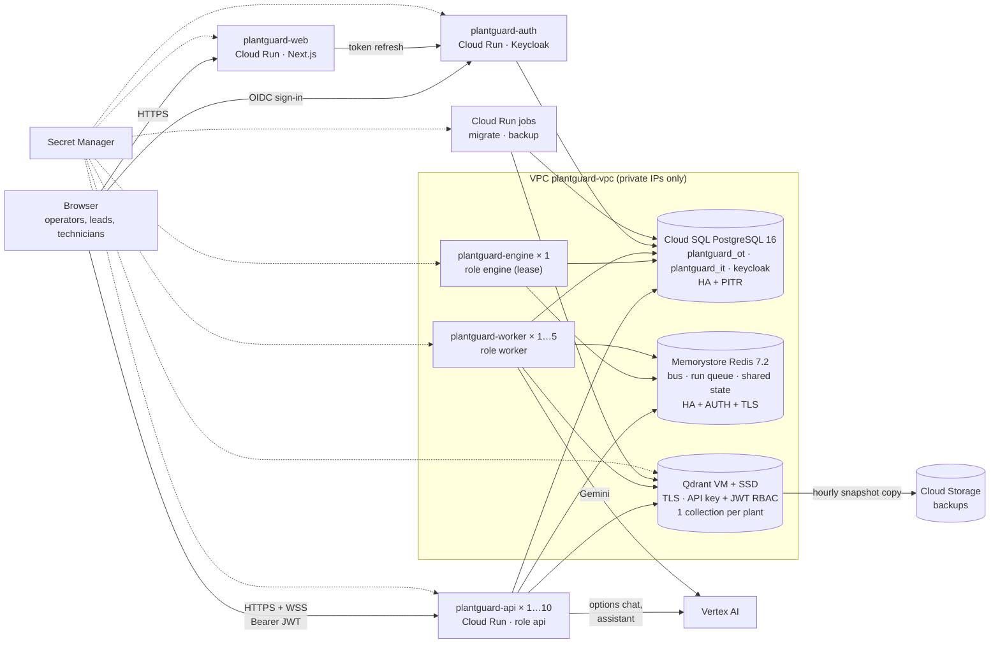

# PlantGuard AI on Google Cloud: deployment guide (approach 2)

This guide brings up every Google Cloud service PlantGuard needs and deploys the code onto them. Everything is
scripted in [`deploy/gcp/`](../deploy/gcp): **Windows batch files** (`01-foundation.bat` … `12-verify.bat`, run from
Command Prompt or PowerShell on your PC), with identical `.sh` twins for Linux/macOS/Cloud Shell. Each step below says what the script creates, why, how to check it, and
what to do when it fails. Roles, shared state and the rules behind them are in CONTRACTS.md, section C12.

- [1. What you are building](#1-what-you-are-building)
- [2. Before you start](#2-before-you-start)
- [3. Step by step](#3-step-by-step) (steps 0 to 12)
- [4. Releasing new versions](#4-releasing-new-versions)
- [5. Security model](#5-security-model)
- [6. Persistence, backup and restore](#6-persistence-backup-and-restore)
- [7. Scaling and performance](#7-scaling-and-performance)
- [8. Operations runbook](#8-operations-runbook)
- [9. The same architecture on one machine](#9-the-same-architecture-on-one-machine)
- [10. What has been tested](#10-what-has-been-tested)
- [11. Troubleshooting](#11-troubleshooting)

---

## 1. What you are building



| Piece | Google Cloud service | Why this one |
|---|---|---|
| Web app | Cloud Run `plantguard-web` | Next.js standalone server; scales to traffic |
| API | Cloud Run `plantguard-api` (role `api`) | stateless, scales out; session affinity keeps a WebSocket on its instance |
| Plant engine | Cloud Run `plantguard-engine` (role `engine`) | the simulation must tick exactly once: min = max = 1, CPU always on, plus a Redis lease so a deploy overlap cannot run two |
| Agent workers | Cloud Run `plantguard-worker` (role `worker`) | long LLM runs off the request path; a crashed worker's run is re-claimed by another |
| Plant + business data | Cloud SQL for PostgreSQL 16 | system of record; HA fail-over; point-in-time recovery; OT and IT in separate databases like a real plant |
| Bus, run queue, caches | Memorystore for Redis 7.2 | sub-millisecond pub/sub between instances; a durable stream for runs; single-use approval tokens; shared rate limits |
| Vector search | Qdrant 1.13 on a Compute Engine VM with an SSD persistent disk | proper collection isolation (manuals + one collection per plant), JWT access per collection, snapshots |
| Sign-in | Keycloak 26 on Cloud Run (database in Cloud SQL) | OIDC with PKCE, roles and plant attributes as claims; the backend still decides permissions |
| LLM | Vertex AI Gemini (`gemini-2.5-flash`) | no API key: the service accounts call it; billed to the project |
| Secrets | Secret Manager | nothing secret in images, env files or the repo |
| Images | Artifact Registry + Cloud Build | one backend image for every role |
| Observability | Cloud Logging, Monitoring, Trace | JSON logs with request id + trace, uptime checks, alerts |

## 2. Before you start

**What you need on your Windows PC**
- [Google Cloud CLI for Windows](https://cloud.google.com/sdk/docs/install) (installer adds `gcloud` to PATH). Then
  `gcloud auth login` once. For step 11 also `gcloud components install beta`.
- Python 3.10+ (the one you run PlantGuard with) with `cryptography` (installed by `pip install -r requirements.txt`;
  otherwise `pip install cryptography`). Only the standard library otherwise. If `python` is not on PATH, set
  `PY=py` in `config.cmd`.
- Nothing else: no Docker, no bash, no openssl. The images are built in Cloud Build, not on your PC.

Run the steps from the project folder, in **Command Prompt** (`deploy\gcp\01-foundation.bat`) or **PowerShell**
(`.\deploy\gcp\01-foundation.bat`). The VM that runs Qdrant is Linux; its boot script `deploy/qdrant/startup.sh` is
uploaded by step 6 (with Linux line endings, even if Git converted it on your PC), you never run it yourself.

How the Windows scripts are built, in case you edit them: `gcloud` is `gcloud.cmd`, so every call is
`call gcloud …` (without `call`, the script would stop after the first command); each command is followed by
`if errorlevel 1 goto :fail`; values that cmd.exe would mangle (env files, certificates, tokens, alert filters) are
written by [`deploy/gcp/tools.py`](../deploy/gcp/tools.py) to files that gcloud reads.

**Optional toggles** are environment variables set on their own line before a step, e.g. in Command Prompt
`set DROP_USERS=1` then `deploy\gcp\08-auth.bat` (in PowerShell: `$env:DROP_USERS=1`). Do not write
`set X=1 && …` in cmd: the value would include a trailing space.

**Permissions.** The person running the scripts needs `Owner` on the project, or: Service Usage Admin, Compute Admin,
Cloud SQL Admin, Cloud Memorystore Redis Admin, Secret Manager Admin, Artifact Registry Admin, Cloud Build Editor,
Cloud Run Admin, Service Account Admin, Project IAM Admin, DNS Administrator, Cloud Scheduler Admin, Monitoring Admin,
Logs Configuration Writer, Storage Admin.

**Billing** must be enabled. Everything runs continuously (min instances = 1, HA database), so this is not a free-tier
setup; see section 7 for the small variant and use the [pricing calculator](https://cloud.google.com/products/calculator)
for your region before you start.

**Get the code:** unzip it (or `git clone`) and open a terminal in the project folder:

```bat
cd C:\path\to\GA_googleaibuild_jpac-development
gcloud auth login
```

## 3. Step by step

Every script is idempotent: if a step fails, fix the cause and run the same script again. It skips what already exists.

### Step 0 · Configuration

```bat
copy deploy\gcp\config.example.cmd deploy\gcp\config.cmd
notepad deploy\gcp\config.cmd
```

Set `PROJECT_ID`, `REGION`/`ZONE`, `ALERT_EMAIL`, `PLANT_IDS`, `TZ_PLANT` (and `PY` if needed).

`PROJECT_ID=pessimist12-1205` and `REGION=asia-south1` are prefilled (Linux/Cloud Shell: `config.env.example` → `config.env`); choose the region closest to the plant. Every
resource is named `<NAME>-…` (default `plantguard`). Cloud Run URLs are known in advance
(`https://plantguard-api-<project number>.<region>.run.app`), so no step has to wait for another to learn a URL.

### Step 1 · Foundation: APIs, image registry, service accounts

```bat
deploy\gcp\01-foundation.bat
```

Enables the APIs (Cloud Run, SQL Admin, Redis, Secret Manager, Vertex AI, …), creates the Artifact Registry repository
`plantguard`, and one service account per component:

| Service account | Used by | Project roles | Secrets it can read |
|---|---|---|---|
| `plantguard-api` | api | log/metric writer, trace agent, `aiplatform.user` | db-password, redis-auth, redis-ca, qdrant-ca, qdrant-app-token, jwt-secret |
| `plantguard-engine` | engine | same as api | same as api |
| `plantguard-worker` | worker | same as api | same as api |
| `plantguard-ops` | migrate + backup jobs | log/metric writer, `aiplatform.user` | as api, plus **qdrant-admin-key** (not the app token) |
| `plantguard-web` | web | log/metric writer | auth-secret, kc-client-secret |
| `plantguard-auth` | Keycloak | log/metric writer | kc-db-password, kc-admin-password, keycloak-realm |
| `plantguard-qdrant` | Qdrant VM | log/metric writer | qdrant-admin-key, qdrant-tls-cert, qdrant-tls-key, qdrant-ca; writes the backup bucket |
| `plantguard-scheduler` | Cloud Scheduler | `run.invoker` | none |

Check: `gcloud iam service-accounts list --filter=plantguard`.

### Step 2 · Private network

```bat
deploy\gcp\02-network.bat
```

Creates `plantguard-vpc` with two subnets (Cloud Run egress `10.20.0.0/24`, Qdrant `10.20.4.0/24`), a private
services access range for Cloud SQL and Memorystore, firewall rules (Qdrant port 6333 only from those subnets, SSH only
through Identity-Aware Proxy), Cloud NAT for the Qdrant VM (it has no public IP) and the private DNS zone
`plantguard.internal`.

Check: `gcloud compute networks subnets list --network=plantguard-vpc` and
`gcloud services vpc-peerings list --network=plantguard-vpc` (one peering to `servicenetworking`).

### Step 3 · Secrets

```bat
deploy\gcp\03-secrets.bat
```

Generates random secrets straight into Secret Manager (they never touch the disk): `jwt-secret` (signs approval
tokens), `db-password`, `kc-db-password`, `qdrant-admin-key`, `auth-secret`, `kc-client-secret`, `kc-admin-password`.
Placeholders are created for values later steps fill in (Redis AUTH + CA, Qdrant certificates, Qdrant app token, the
Keycloak realm). Each secret is readable only by the service accounts in the table above. Running it again keeps
existing values.

Check: `gcloud secrets list --filter=labels.app=plantguard`.

### Step 4 · Cloud SQL for PostgreSQL

```bat
deploy\gcp\04-database.bat
```

One PostgreSQL 16 instance (Enterprise edition, `db-custom-2-7680`): **private IP only**, **TLS required**
(`ENCRYPTED_ONLY`), **regional HA** (standby in another zone, automatic fail-over), daily backups kept 14 days,
**point-in-time recovery** (7 days of WAL), query insights, slow-query logging, password policy, deletion protection.
Databases: `plantguard_ot`, `plantguard_it`, `keycloak`; users `plantguard` (both PlantGuard databases) and `keycloak`.
PlantGuard creates and upgrades its own tables (step 9), so nothing else is needed.

Optional hardening (recommended): make each user own only its databases and nothing else (needs `psql` on a machine
that can reach the private IP, e.g. a small VM in the VPC, or Cloud Shell):

```bat
gcloud sql users set-password postgres --instance=plantguard-pg --prompt-for-password
rem then, on a machine inside the VPC:
psql "host=<private ip> user=postgres sslmode=require" -f deploy/gcp/sql/grants.sql
```

Check: `gcloud sql instances describe plantguard-pg "--format=value(state,settings.availabilityType,ipAddresses[0].ipAddress)"`
→ `RUNNABLE REGIONAL 10.x.x.x`.

### Step 5 · Memorystore for Redis

```bat
deploy\gcp\05-redis.bat
```

Redis 7.2, **Standard tier** (replica in another zone, automatic fail-over), **AUTH** on, **in-transit TLS**
(port 6378), hourly RDB snapshots, `volatile-lru` eviction (only keys with a lifetime may be evicted; the run queue and
shared state never are). The AUTH string and the server CA certificate go to Secret Manager; the services mount the CA
as a file and connect with `rediss://`.

What lives in Redis is listed in CONTRACTS C12. Redis is *not* the system of record: if it is lost, the engine rebuilds
the caches and re-queues analyses that never started (PostgreSQL holds every incident and event).

Check: `gcloud redis instances describe plantguard-redis --region=asia-south1 "--format=value(state,tier,transitEncryptionMode)"`.

### Step 6 · Qdrant vector service

```bat
deploy\gcp\06-qdrant.bat
```

What it creates:

1. **Backup bucket** `gs://<project>-plantguard-backups` (uniform access, no public access, versioned, objects
   deleted after 30 days).
2. **TLS**: a private CA and a server certificate for `qdrant.plantguard.internal`
   (`tools.py certs`; on Linux [`deploy/qdrant/make_certs.sh`](../deploy/qdrant/make_certs.sh)). The CA certificate, server certificate and key go to
   Secret Manager; the CA private key is not kept (re-run with a new CA to rotate).
3. **Data disk** `plantguard-qdrant-data` (SSD, 50 GB) with a **daily snapshot schedule** (14 days). The disk is
   independent of the VM (`auto-delete=no`): replacing or deleting the VM never deletes the vectors.
4. **VM** `plantguard-qdrant` (Debian 12, `e2-standard-2`, Shielded VM, **no public IP**, OS Login). Its boot script
   ([`deploy/qdrant/startup.sh`](../deploy/qdrant/startup.sh)) mounts the disk, reads the master API key and TLS files
   from Secret Manager, runs Qdrant in Docker with **TLS + API key + JWT RBAC**, installs the Ops Agent (logs + metrics)
   and an hourly timer that copies collection snapshots to the bucket.
5. **DNS** `qdrant.plantguard.internal` → the VM's private IP.

**Collection isolation.** The migrate job (step 9) creates:

| Collection | Content | Who can access it |
|---|---|---|
| `plantguard_prod_manuals` | equipment manual sections (shared knowledge) | app token: **read** |
| `plantguard_prod_workorders_plant_a` | Plant A's closed repairs | app token: read/write; a Plant A token: read/write; nobody else |
| `plantguard_prod_workorders_plant_b` | Plant B's closed repairs | same, for Plant B |

The prefix includes the environment (`plantguard_<ENV>`), so staging and production can even share one cluster without
seeing each other. Inside the app, a search opens only the collections of the plants the user may see (a machine-scoped
search: only that machine's plant), and the catalogue rows are filtered by plant again (defence in depth). The services
never hold the master key: they get a **JWT that names exactly these collections** (step 9). A token cannot list,
create or delete collections, and a plant token cannot read another plant's collection (tested, section 10).

Check (boot takes ~2 minutes):

```bat
gcloud compute instances get-serial-port-output plantguard-qdrant --zone=asia-south1-a | findstr /c:"qdrant started" /c:"ERROR"
gcloud compute ssh plantguard-qdrant --zone=asia-south1-a --tunnel-through-iap --command="sudo docker logs --tail 20 qdrant"
```

### Step 7 · Build the images

```bat
deploy\gcp\07-build.bat
```

Cloud Build ([`deploy/gcp/cloudbuild.yaml`](../deploy/gcp/cloudbuild.yaml)) builds three images and pushes them with
the git commit as tag:

| Image | Dockerfile | Notes |
|---|---|---|
| `…/plantguard/api` | [`Dockerfile`](../Dockerfile) | one image for every backend role; multi-stage; runs as uid 10001; uvicorn with graceful shutdown |
| `…/plantguard/web` | [`p3-frontend/Dockerfile`](../p3-frontend/Dockerfile) | Next.js `standalone`; the API URL is baked in at build time |
| `…/plantguard/auth` | [`deploy/keycloak/Dockerfile`](../deploy/keycloak/Dockerfile) | Keycloak 26 pre-built for Postgres (`start --optimized` starts in seconds) |

The upload honours [`.gcloudignore`](../.gcloudignore) (no `node_modules`, no local data).

### Step 8 · Keycloak (sign-in)

```bat
deploy\gcp\08-auth.bat
```

Generates the production realm from `config/keycloak/plantguard-realm.json` with
[`deploy/keycloak/prepare_realm.py`](../deploy/keycloak/prepare_realm.py): the web client's redirect, logout and
web-origin URLs become the production web URL, it gets the generated client secret, the password-grant test client is
removed, SSL is required for every connection, brute-force protection and a password policy (12+ characters, not the
username/email, no reuse of the last 3) are on, and refresh tokens are single use.

Users: by default the demo users are kept so the seeded plant (whose technicians and approvers have ids such as
`USR-lead`) works, **each with a random one-time password** written to `deploy/gcp/initial-passwords.csv`. Keycloak
forces a new password at first sign-in. Hand them out and delete the file. `set DROP_USERS=1` before `08-auth.bat`
removes them instead; then create real users in the admin console with the attributes `user_id` (the PlantGuard user
id) and `plant_ids`, and one realm role (`operator`, `maintenance_lead`, `plant_manager`, `technician`, `admin`).

Keycloak runs as one instance with a local cache (Cloud Run has no cluster discovery); its state is in PostgreSQL, so a
restart loses nothing but open sign-in pages. The realm is imported only when it does not exist yet; to change it
later use the admin console (`<auth url>/admin`, user `kcadmin`).

Check: `curl -s https://plantguard-auth-<number>.<region>.run.app/realms/plantguard/.well-known/openid-configuration | head -c 200`.

### Step 9 · Migrate job and the Qdrant app token

```bat
deploy\gcp\09-migrate.bat
```

Creates the Cloud Run job `plantguard-migrate` (`python -m app.ops migrate`) and runs it. It creates or upgrades both
schemas (under a PostgreSQL advisory lock, so it is safe even if a service starts at the same time), seeds a new plant
when the database is empty, creates the Qdrant collections and indexes the manuals and the closed repairs. It is
idempotent: run it before every release (the CI pipeline does). It uses the Qdrant **admin** key; it is the only
component that can create collections.

Then it mints the app's Qdrant JWT (`tools.py token`; on Linux [`deploy/qdrant/mint_token.sh`](../deploy/qdrant/mint_token.sh);
valid 365 days) and stores it as `plantguard-qdrant-app-token`.

Check: `gcloud run jobs executions list --job=plantguard-migrate --region=asia-south1 --limit=1` → succeeded; the job log
ends with `{"migrated": true, … "vector_store": "qdrant", "chunks": 80}`.

### Step 10 · The services

```bat
deploy\gcp\10-services.bat
```

| Service | Role | Ingress | Instances | CPU / RAM | Notes |
|---|---|---|---|---|---|
| `plantguard-engine` | engine | internal | 1 / 1 | 1 / 1 GiB | CPU always on; holds the plant lease |
| `plantguard-worker` | worker | internal | 1 / 5 | 2 / 2 GiB | CPU always on; 4 analyses at a time each |
| `plantguard-api` | api | public | 1 / 10 | 2 / 2 GiB | session affinity; 60 min request timeout (WebSockets); 80 concurrent requests |
| `plantguard-web` | — | public | 1 / 5 | 1 / 1 GiB | Auth.js with Keycloak |

All backend services: direct VPC egress to private ranges (Cloud SQL, Redis, Qdrant on private IPs; Vertex AI over
Google's network), secrets as env vars or mounted files, **startup probe `/readyz`** (fails until PostgreSQL, Redis and
Qdrant all answer), **liveness probe `/healthz`**, gen2 execution environment, startup CPU boost.

It also creates the `plantguard-backup` job (Qdrant collection snapshots) and a Cloud Scheduler trigger every 6 hours.

At the end it prints the URLs. Open the web URL and sign in with one of the users from step 8.

### Step 11 · Observability and alerts

```bat
gcloud components install beta
deploy\gcp\11-observability.bat
```

Creates an e-mail notification channel (`ALERT_EMAIL`), uptime checks for the API (`/healthz`) and the web app, the
log-based metric `plantguard_backend_errors`, and alert policies: API 5xx rate, backend error rate, Cloud SQL CPU > 80 %,
Redis memory > 80 %, Qdrant VM CPU > 85 %.

Logs are JSON with `severity`, `request_id` and the Cloud Trace id, so Logs Explorer groups each request. Bearer
tokens are redacted from every log line (WebSocket URLs carry `?token=`).

```
resource.type="cloud_run_revision" resource.labels.service_name="plantguard-api" severity>=WARNING
jsonPayload.request_id="<id from the X-Request-ID response header>"
```

### Step 12 · Verify

```bat
deploy\gcp\12-verify.bat
```

Checks: API health, Keycloak mode, anonymous calls refused (401), `/docs` hidden, web login page, realm discovery,
security headers (HSTS, nosniff, frame-deny), engine and worker not reachable from the internet, last migrate run.
Then do the business check by hand: sign in as the maintenance lead, open the incident the engine raised, ask for a
different plan in the options chat, approve, sign the release as the other plant's lead, and follow the technician's
job to "Closed".

## 4. Releasing new versions

**By hand:** `deploy\gcp\release.bat` (builds the images in Cloud Build, runs the migrate job, rolls out engine →
worker → api → web; the tag is the git commit, or set `TAG` in `config.cmd`).

**CI/CD:** create a Cloud Build trigger on your main branch with `deploy/gcp/cloudbuild.yaml` and the substitutions
`_DEPLOY=true`, `_REGION`, `_API_URL`, `_PLANT_TZ`, `_TAG=$SHORT_SHA`. The pipeline builds and pushes the images, runs
the migrate job, then rolls out engine → worker → api → web. Each rollout waits for the startup probe; a revision that
does not become ready never gets traffic.

**Rules that keep rollouts safe:**
- Schema changes are additive (new tables/columns with defaults), so old and new revisions run side by side.
- The engine lease makes the new engine wait until the old one has stopped (at most 15 s).
- A worker that is stopped mid-analysis does not acknowledge its queue entry; another worker re-claims it and restarts
  that round (partial events are dropped first).
- API instances drain WebSockets on SIGTERM (clients reconnect with `after_seq` and miss nothing).

**Roll back:** `gcloud run services update-traffic plantguard-api --to-revisions=<previous>=100` (same for the others),
or redeploy the previous tag.

## 5. Security model

| Layer | Control |
|---|---|
| Network | Only `api`, `web` and `auth` are public. Engine and worker: internal ingress, no unauthenticated invocations. Cloud SQL and Redis: private IP only. Qdrant: no public IP, firewall allows only the Cloud Run egress subnet; SSH only via IAP. |
| Transport | HTTPS everywhere public (Cloud Run TLS, HSTS). Inside the VPC: PostgreSQL `sslmode=require` (instance enforces encryption), Redis TLS with the server CA, Qdrant TLS with a private CA (clients verify it). |
| Identity | Keycloak OIDC (authorization code + PKCE, confidential client), 15-minute access tokens, single-use refresh tokens, brute-force protection, password policy. The backend verifies the token signature (JWKS), issuer and audience on every call and WebSocket. |
| Authorization | Backend RBAC (role → permissions) and plant scope on every route and tool call; approvals need the right signers (lead, other plant's release, manager co-sign over €10,000 / 4 h stop); writes need a single-use approval token (Redis `SET NX`, so not replayable on another instance). |
| Vector data | Collection per plant; services hold a JWT naming only their collections; the master key exists only on the VM and in the migrate/backup jobs. |
| Secrets | Secret Manager, one service account per component, each with access to only its secrets. Nothing secret in images, the repo or env files. |
| Service identity | No service account keys anywhere: Cloud Run and the VM use their attached service accounts (Vertex AI, Secret Manager, Storage). |
| Application | `PLANTGUARD_ENV=prod` refuses demo secrets, `CORS_ORIGINS=*` and `SIM_RESET`; hides `/docs` and the demo-user list; security headers (CSP, nosniff, frame-deny, referrer, permissions, HSTS); CORS allow-list with explicit methods/headers; per-client rate limit shared across instances; tokens redacted from logs; containers run as non-root. |
| Audit | Every login, decision, tool call and write is in the hash-chained audit log (PostgreSQL; appends serialised with an advisory lock so the chain stays intact with many instances). |

Recommended extras for a public production URL: put the API and web behind an external HTTPS load balancer with
Cloud Armor (WAF rules, per-IP rate limiting) and switch their ingress to `internal-and-cloud-load-balancing`; enable
Binary Authorization; turn on VPC Service Controls around the project.

**Rotating secrets:**
- JWT secret: put a new random value in a file and `gcloud secrets versions add plantguard-jwt-secret --data-file=new.txt`
  (then delete the file), then `10-services.bat` (open approval tokens become invalid; users just approve again).
- Qdrant app token: `set ROTATE_QDRANT_TOKEN=1`, `09-migrate.bat`, then `10-services.bat`.
- Qdrant master key: add a new version, restart the VM (`gcloud compute instances reset`), re-mint the app token.
- Database passwords: add a version, run `04-database.bat` (sets the user's password from the secret), redeploy.

## 6. Persistence, backup and restore

| Data | Persistence | Backup | Restore |
|---|---|---|---|
| Plant, ERP/MES/CMMS, incidents, events, audit, sessions | Cloud SQL (HA, synchronous standby) | daily backups (14 days) + point-in-time recovery (7 days) | `gcloud sql instances clone plantguard-pg plantguard-pg-restore --point-in-time=2026-10-15T08:00:00Z`, check it, then point `DB_HOST` at it (or restore a backup in place: `gcloud sql backups restore <id> --restore-instance=plantguard-pg`) |
| Keycloak users and sessions | Cloud SQL `keycloak` database | same | same |
| Vectors (manuals, repairs) | Qdrant on an SSD persistent disk | daily disk snapshots (14 days) + collection snapshots every 6 h, copied to Cloud Storage hourly | see below |
| Bus messages, run queue, caches | Memorystore (replica + RDB) | not needed | rebuilt: the engine re-queues analyses that never started, caches refill within seconds |
| Plant clock | Cloud SQL (`meta`) | with the database | — |

**Restoring Qdrant**, from the least to the most drastic:
1. One collection from its snapshot (on the VM):
   `curl --cacert ca.pem -H "api-key: $KEY" -X PUT "https://qdrant.plantguard.internal:6333/collections/<name>/snapshots/recover?wait=true" -d '{"location":"file:///qdrant/snapshots/<name>/<file>.snapshot","priority":"snapshot"}'`
   (snapshots from Cloud Storage: `gcloud storage cp` them into `/mnt/disks/qdrant/snapshots/<name>/` first).
2. The whole disk: create a disk from a snapshot, stop the VM, swap the data disk, start it.
3. From scratch: the vectors can always be rebuilt from PostgreSQL (manuals + every closed repair are in the IT
   database): `gcloud run jobs execute plantguard-migrate` after deleting the collections, or run
   `python -m app.ops reindex` as a one-off job.

Test a restore every quarter (clone the database at a point in time, recover one collection on a test VM).

## 7. Scaling and performance

- **API** scales on concurrent requests (80 per instance). WebSockets count as requests for their whole life, so the
  max instances must cover viewers ÷ 80. Every instance answers every call: state is in PostgreSQL/Redis, events fan
  out over Redis pub/sub, telemetry from the engine reaches every API instance on `ot.raw.<plant>.<line>`.
- **Workers** scale on CPU; analyses are mostly waiting on the LLM, so size by `WORKER_MIN × WORKER_CONCURRENCY` ≥ the
  analyses you expect at once. `python -m app.ops check` (or the job logs) shows the queue depth.
- **Engine** is a single writer by design (one simulated plant). For many real plants, each plant's data comes from
  its own OT gateway instead; the API and workers already scale.
- **Database connections**: each backend instance opens at most `PLANTGUARD_DB_POOL_SIZE` (8) per database, i.e. 16.
  Worst case 10 api + 5 workers + engine + jobs ≈ 290 + Keycloak; the instance allows 500 (`max_connections`). Raise
  both together if you raise the max instances.
- **Fast paths**: the rate limiter is one pipelined Redis round trip; health scores, latest telemetry and garden
  positions are served from Redis; document search fetches all hits in one query; Qdrant searches only the collections
  that matter; incident writes use optimistic locking instead of table locks.
- **Small/cheap variant** (demo, staging): `SQL_HA=ZONAL`, `SQL_TIER=db-custom-1-3840`, `REDIS_TIER=basic`,
  `QDRANT_MACHINE=e2-small`, `API_MAX=3`, `WORKER_MAX=2`.

## 8. Operations runbook

| Situation | What to look at | Fix |
|---|---|---|
| Analyses do not start | worker logs `worker: analysing …`; `app.ops check` → `run_queue_depth` | worker instances up? Vertex AI quota? Raise `WORKER_MIN` |
| Plant time stands still | engine logs `lease … acquired`; `engine_lease_holder` | engine service has 1 ready instance? If the lease holder is gone it frees itself after 15 s |
| `/readyz` 503 | its JSON says which check fails (`it_db`, `redis`, `vector_store`) | network/egress settings, secret versions, the backing service's status |
| Qdrant unreachable | `gcloud compute ssh … -- sudo docker ps`, serial port output | `sudo docker restart qdrant`; the disk keeps the data |
| "This issue was just changed by someone else" (409) | normal under concurrent edits | the user reloads; the run coordinator merges by itself |
| Rate limited (429) | `Retry-After` header | raise `RATE_LIMIT_PER_MIN` / `RATE_LIMIT_BURST` |
| Add a plant | — | add it to `config/plant.yaml`, add it to `PLANT_IDS`, run the migrate job, re-mint the app token, redeploy |
| LLM errors | worker logs; `python -m llm.check` in a one-off job | Vertex AI API enabled, `aiplatform.user` on the service account, model available in `VERTEX_LOCATION` |

## 9. The same architecture on one machine

```bat
docker compose up --build -d
open http://localhost:3000     # lead / demo
```

[`docker-compose.yml`](../docker-compose.yml) runs PostgreSQL (OT, IT and Keycloak databases), Redis with a password,
Qdrant with an API key and JWT RBAC, the migrate job, one engine, two workers, two API instances behind an nginx
gateway with sticky sessions (`:8000`) and the web app (`:3000`) (Docker Desktop on Windows);
`docker compose --profile sso up --build -d` adds Keycloak. Same image, same roles,
same isolation as in the cloud (only TLS inside the network is left out).

## 10. What has been tested

Before this guide was written, the code ran as a production-like system on one machine: PostgreSQL 16, Redis 7,
Qdrant 1.13 with **TLS + API key + JWT RBAC**, the migrate job, one engine, one worker and two API instances started
from the image's file layout with `PLANTGUARD_ENV=prod`, plus the Next.js standalone build. Verified:

- full business flow across instances: incident raised by the engine → analysed by the worker → options chat on API 1
  → approval chain on API 2 (decline, re-approve, cross-plant release) → technician on both instances → machine check
  decided by the engine → closed → the new repair is searchable in Qdrant (Playwright UI run included);
- plant speed changed on one API instance reaches the engine and the other API instance;
- a question asked while no worker runs waits in the queue; a viewer on the other API instance streams it live when a
  worker starts; live telemetry and garden streams through any API instance;
- engine fail-over: a second engine waits on the lease and takes over within seconds;
- every process shuts down in ~2 s on SIGTERM, even with open WebSockets;
- Qdrant isolation: a plant token cannot read the other plant, write manuals or create collections; a forged or
  missing token is refused; clients refuse a server certificate not signed by the private CA; snapshot → wipe →
  recover restores a collection;
- automated tests: `make test` (175), P1 unit + integration (61), P2 agents (68), and `make test-dist` against real
  PostgreSQL/Redis/Qdrant (atomic ids across 8 threads, transaction rollback, cross-process locks, optimistic locking,
  Redis bus between two clients, run-queue re-claim + heartbeat, single-use claims, shared rate limit, engine lease,
  Qdrant JWT isolation);
- the Windows deploy scripts: every step run under a `cmd.exe` implementation (Wine) with a stand-in `gcloud` that
  records each call, for both "nothing exists yet" and "everything exists" (re-run) paths, checking the exact
  command lines; every `gcloud` command and flag checked against `gcloud --help` (Cloud SDK 570); `tools.py`
  certificates and tokens tested against a real Qdrant with TLS + JWT RBAC. The `.sh` twins: `bash -n`, ShellCheck,
  the same flag check. `docker compose config` validates the compose file.

Not run from here (no access to your Google Cloud project): the scripts against real Google Cloud APIs and the Docker
image builds. Expect to run each step once, read its output, and re-run after fixing anything project-specific (org
policies, quotas, region availability).

## 11. Troubleshooting

| Symptom | Cause | Fix |
|---|---|---|
| `vpc-peerings connect` fails | org policy or an overlapping range | change `PSA_RANGE_PREFIX` / the subnet ranges in `config.env` |
| Cloud SQL create: tier not supported | Enterprise Plus default | the script sets `--edition=ENTERPRISE`; check `SQL_TIER` is a `db-custom-*` tier |
| Service never becomes ready | startup probe on `/readyz` | `gcloud run services logs read plantguard-api --limit=50`; the readyz JSON names the failing dependency |
| `https://…run.app/healthz` answers 404 | Cloud Run's front end reserves `/healthz` on `run.app` URLs; the probes still use it inside | use `/health` or `/auth/config` from outside |
| `CERTIFICATE_VERIFY_FAILED` to Qdrant | client CA ≠ server's CA | re-run `06-qdrant.bat` after deleting the `qdrant-ca` secret versions, then `gcloud compute instances reset plantguard-qdrant` and redeploy |
| Qdrant 403 | token names other collections (prefix or plant list changed) | `set ROTATE_QDRANT_TOKEN=1`, `09-migrate.bat`, then `10-services.bat` |
| Keycloak "Invalid redirect uri" | realm generated for another web URL | `set REGENERATE_REALM=1` + `08-auth.bat` only works before the realm exists; otherwise fix the client's URLs in the admin console |
| 401 on every API call after sign-in | issuer mismatch | `KEYCLOAK_URL` must equal the Keycloak public URL (the token's `iss` without `/realms/…`) |
| `production configuration refused` at startup | a demo setting in prod | the message lists them (JWT secret, CORS, SIM_RESET) |
| Plant reset needed (demo) | — | `gcloud run jobs execute plantguard-migrate --update-env-vars=SIM_RESET=1` wipes and reseeds (production refuses `SIM_RESET` on services, only the job may) |
